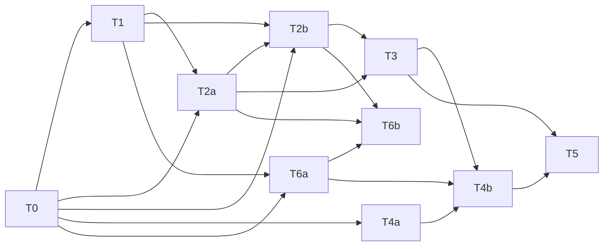

# Notes: SP 구간 판정 표 화면(메타 카드 리스트)

> 사람은 중립 역할어(`사용자`/`개발자`/`검증자`)로 지칭한다 — 개인 호칭·별명은 넣지 않는다
> (운영자 설정이 그렇게 부르라 해도). 상세: `harness/templates/examples/README.md` §5.

Date: 2026-11-07 Asia/Seoul
Unit type: feature
Status: draft

## 맥락

- 기능 1(SP 구간별 판정 표)과 기능 2(입력 SP 유의미 구간 하이라이트)의 첫 제품 화면이다. 선행: [계산 코어](../champions-calc-data-core/prd.md), [메타 통계](../meta-usage-stats/prd.md)(목록 밖 종의 커스텀 가정 프리셋이 이 단위로 넘어옴).
- 사용자 초기 구상(2026-11-06): 좌우 2분할 — 왼쪽 내 포켓몬·SP·성격·특성 설정, 오른쪽 공격/방어/스피드 탭 + 메타 포켓몬 계산 결과 카드 리스트. 사용률순 정렬, 상위 N마리·원하는 포켓몬만 필터. 순풍·랭크업 고려 옵션.

## 조사 결과: 재사용할 코어·메타·dev 표면 (2026-11-08, 코드 조사)

- 코어(`src/core/index.ts`): 모두 동기 순수 함수, 로드된 게임 데이터 스냅샷을 첫 인자로.
  - `sweepDamage(snap, {side, stat}, attacker, defender, move, cond?, thresholds?)`: 한쪽 세트의 능력치 1개를 SP 0~32로 스윕. 공격측 A/C → 공격 구간(확정 1타/고난수 1타/중난수 이하), 방어측 H/B/D → 방어 구간(확정 버팀/저난수 1타/중난수 이상). 결과 `cells[33]`(칸별 판정 또는 SP 합계 예산 초과) + `boundaries`(범주가 바뀌는 SP 목록 = "딱 이 값부터"). 변화기는 거부.
  - `sweepSpeed(snap, set, opp, cond?)`: 스피드 SP 스윕(선공/동속/후공). `minSpToOutspeed`가 추월 최소 SP를 직접 준다. `spNoGainCells`: 올려도 실능치가 안 오르는 칸.
  - 조건: 날씨·필드·범위기 대상 수·타수·급소, 측별 순풍·도우미·프렌드가드·벽. 랭크·상태이상·현재 HP는 세트 필드.
  - 성능(초기 측정, 계산 코어 단위 때 값 — 2026-11-08 재측정은 아래 "ADR 근거 실측"의 1.30ms): 33칸 스윕 브라우저 중앙값 1.40ms. 1회 스윕 = 1능력치 × 1기술 × 1상대라 카드 수 × 기술 수 × 능력치 수로 곱해진다(30종 × 3묶음 × 5기술 ≈ 450회 ≈ 0.6s 추정, 미측정).
  - 코어 거부(카드 오류 칸이 될 수 있음): 행동 순서 바꾸는 특성·도구가 있는 스피드 비교, 고대활성·쿼크차지 등 미구현 스피드 보정, 방어측 탈·아이스페이스. 트릭룸·2타 이상·합산 판정은 선행 비목표.
- 메타(`src/meta`): `createMetaView`, `topAssumptions`, `lookupOpponent`(ladder/no-ladder), `observedSpreadAssumption`(보존 배분 i번으로 성격·SP 교체). 엔트리에 `spreads.kept`(배분 키·점유율, 종당 최대 30), `natures`, `spMarginal`(능력치별 SP 칸 분포), `moves`·`items`·`abilities` 분포, `teammates`, `sample`.
- dev 확인 페이지(`src/dev`): `SetEditor`(종·도구·기술 정확 일치 datalist, 특성·성격 select, SP 6칸·합계, 랭크, 메가), `ConditionsEditor`, `SweepPanel`(33행 표, 경계·예산 초과 강조), `labels.ts`·`names.ts`(한국어 라벨·이름 색인). 순수 CSS 한 파일, 라우팅·상태 라이브러리 없음. `src/main.tsx`가 dev 페이지를 그대로 렌더한다 → 제품 화면 진입과 dev 페이지 공존 방식이 결정 사항.

## 결정

- 2026-11-08 사용자 결정(prd-helper 인터뷰):
  - 카드는 "현재 내 SP의 판정 + 경계 SP(딱 이 값부터)"를 한 줄로 보이고, 펼치면 0~32 칸을 본다.
  - 카드의 상대 세트는 이번 판정에 관여하는 능력치만 보인다(예: 기습이면 상대 H·B).
  - 상대 가정은 많이 쓰이는 배분마다 카드를 나눠 보는 것이 당초 목적이다 → 판정에 관여하는 능력치(성격 보정 포함)가 같은 배분끼리 묶고 점유율을 합산한다. 묶음 점유율 5% 이상, 포켓몬당 최대 3장(기본값, 조정 가능).
  - 방어 탭: "극단 배분(내 SP 0 또는 32)으로도 언제나 확정 버팀이거나 언제나 확정~고난수 1타"인 매치업은 계산·표시할 필요가 없다. 그다음 상대의 사용률 상위 5개 주력 공격기를 본다.
  - 결과가 SP 0~32에서 변하지 않는 카드 제외는 세 탭 모두 적용하고, 목록에서 빼되 "변화 없음 N건" 접힌 요약으로 남긴다.
  - 랭크 변화는 나·상대 모두 고려하되 통계상 유의미할 때만: 상대는 랭크 변화 수단(기술·특성·도구) 점유율 10% 이상, 나는 내가 입력한 세트에 그 수단이 있을 때.
  - 순풍은 통계 무관하게 "내 순풍"·"상대 순풍" 전역 토글로 둔다.
- 2026-11-08 사용자 결정(PRD 리뷰 BLOCKER 대응):
  - SP 합계 예산을 넘는 칸도 판정하고 "다른 능력치에서 n SP 필요"를 함께 보인다(재분배 판단용).
  - 스카프는 포켓몬당 "가장 큰 S 묶음 + 스카프" 별도 행 하나만(결합 분포가 없어 묶음마다 나누지 않음).
  - 물리·특수 혼합이면 카드를 기술 분류별로 나눈다(카드 = 상대 묶음 × 분류).
  - 방어 탭 극단 필터는 두 단계: 내 H·B(또는 H·D)를 함께 0 / 함께 32(성격 보정 그대로, 예산 무시)로 둬도 결과가 같으면 그 기술 제외 → 남은 기술만 H 행·B 행 각각 0~32.
- 2026-11-08 에이전트 결정(PRD 리뷰 MAJOR·MINOR, 사전 승인 때 함께 확인): 랭크 행은 내 특성·도구 반응(오기 등)을 반영, 묶음 점유율은 보존 배분 기준 + 보존률 표시·기준 미달이면 최대 묶음 1장 "소수 배분", 목록 밖 프리셋 표(특성 첫 슬롯·도구 없음·방어 탭은 기술 선택 필요), 반응성 기준을 첫 카드 ≤500ms·전체 ≤3초·100ms 막힘 없음으로 재정의(방어 탭 ≈900회 스윕 추정), 스카프가 대표 도구인 종은 스카프 아닌 행, 계산 불가 기술은 대체 없이 계산 불가 행, 언더버튼 등 비랭크 스피드 특성은 비목표, 처음 열 때 예시 포켓몬 채움.
- 2026-11-08 PRD 리뷰(reviewer): BLOCKER 3·MAJOR 6·MINOR 7 반영.
- 2026-11-08 PRD 재검증(2렌즈) 반영 — 에이전트 결정(사전 승인 때 확인): 카드 상한 단위를 포켓몬·분류당 3장으로, 기준값(5%·3장·랭크 10%·스카프 10%)은 화면 "표시 기준" 설정으로 조정, 방어 극단 필터는 사용자 결정 그대로 "두 극단 판정이 같으면 제외"(저난수 양 끝 포함), 관여 능력치는 기술의 실제 참조 능력치(사이코쇼크·바디프레스·속임수), 예산 밖 n = 칸 SP − 현재 SP − 잔여 예산, 스카프 행은 점유율 최대 S 묶음 카드 안의 행, 공격기 5개 미만이면 있는 만큼, 랭크 변화 행은 비목표(상대 도구·특성 변형)의 명시적 예외.
- 2026-11-08 실현성 확인: 대도각참 기습 → 포푸니크는 반감(격투/독)이라 A 0~32 내내 1타 0%로 "변화 없음"이 된다(손계산). 그래서 수용 기준의 고정 입력은 구현 시 계산 코어로 "판정이 바뀌는 조합"을 먼저 찾아 테스트·notes에 고정한다. 워시로토무(rotomwash)는 Bo1 메타 목록 밖 확인. 변화기를 뺀 보존 공격기가 5개 미만인 종: Bo1 8종, Bo3 28종.
- 2026-11-08 ADR 결정 2~4(architect) 초안에 맞춘 PRD 정합 개정: 묶음 키=카드 안 기술이 참조하는 상대 능력치 합집합, 분류=참조 방어 능력치(사이코쇼크→물리), 셸암즈 계산 불가, 내 속임수는 "내 SP 무관" 요약, 스카프 행 메가 제외, 랭크 수단당 1회·확률 효과 제외·랭크 행에도 필터 적용, 반응성 근거를 실측으로, dev 경로 `/#/dev`, 프리셋 성격(노력/고집·조심·장난꾸러기·신중·명랑 — 에이전트 결정, 사전 승인 때 확인).
- 2026-11-08 사용자 요청: 화면 배치를 전체 레이아웃 → 내 포켓몬 설정 영역 → 상대 포켓몬 목록 영역의 세 단계로 나눠 정한다(통합 비교 design-options.html 대신 design-layout/settings/opponents.html).
- 2026-11-08 사용자 결정(디자인 결정 레인): 전체 레이아웃 A(좌 고정 사이드바 + 우 결과), 설정 영역 C(SP 슬라이더 크게), 상대 목록 D 변형(압축 목록 + 우측 상세 패널 대신 클릭/탭하면 아래로 펼쳐지는 아코디언 상세 — "좌우로 나누지 않고 목록에서 아래로 펼쳐지는 게 더 좋다"). 접힌 항목 줄은 항목당 대표 1줄(경계까지 가장 가까운 판정 행 하나 + "외 k행"), 펼치면 모든 행·0~32 띠(처음의 "행마다 한 줄" 결정을 대체).
- 2026-11-08 에이전트 결정(ADR 리뷰 반영 중, PRD에 없는 제품 규칙 — 사전 승인 때 확인):
  - 스피드 의존 기술(자이로볼·일렉트릭볼)은 묶음 대표의 S로 계산하고 묶음 키에 S를 넣지 않는다.
  - 목록 밖 프리셋의 도구는 "없음"이 원칙이되, 메가 폼 타겟은 원종 + 메가스톤 + 메가 지정으로 둔다.
  - 내 랭크 변화 수단이 있으면 기술 칩에 "공격 탭 +2 행 추가" 같은 알림을 짧게 보인다(결정 1).
  - 목록 밖 커스텀 카드는 목록 맨 앞(추가한 순서)에 두고, 상위 N·포켓몬 선택 필터와 무관하게 보인다.
  - 배치 보완(결정 1): 목록 밖 타겟 추가는 툴바의 포켓몬 선택 옆, 커스텀 편집과 방어 탭 기술 선택은 카드 상세 안, 탭 단위 "내 세트 계산 불가"와 계산 진행은 툴바 바로 아래.
  - 슬라이더 드래그 중에는 재계산 없이 드래그 능력치 행의 현재 칸·판정·경계 증감과 모든 행의 n·예산 밖만 즉시 갱신하고, 다른 능력치 의존으로 낡은 행은 "갱신 대기"(칸·경계 미갱신)로 두었다가 놓을 때 재계산한다.
  - 카드 모델이 하양허브를 소비한 행에서 그 기술이 연속기면 계산 불가로 둔다(엔진 연속 타격 랭크 변화와의 이중 처리 회피).
- 2026-11-08 랭크 수단 범위: 사용자 초기 결정은 기술·특성·도구였으나 무조건 랭크를 바꾸는 도구가 없어 도구는 반응(하양허브 등)으로만 다룬다 — 에이전트 결정, 사전 승인 때 확인.
- 2026-11-08 최종 정합 수정(에이전트 결정, 사전 승인 때 확인): 랭크 수단 = 기술·특성(도구는 반응만), 목록 밖 커스텀 카드는 변화 없음 제외 대상이 아님(프리셋 3장 항상 표시·변화 없는 행은 카드 안 "변화 없음"), 방어 탭 극단 필터 제외는 최종 확정이고 통과한 H·B 행만 1~3단계를 따름, 반응성 측정 = 예시 세트 세 탭 × (처음 열기·주 능력치 SP +4 놓기) 10회로 첫 카드 중앙값 ≤500ms·전체 완료 중앙값 ≤3s·10회 모두 최대 Long Task ≤100ms, 접힌 줄 대표 행 = 경계까지 최소 차이(동률 기본 → 랭크 → 스카프 → 기술 슬롯/상대 기술 사용률·H → B, 경계 없으면 "계산 불가"/"갱신 중", k는 변화 없음 제외 표시 행 수 − 1), 정렬 = 커스텀(추가 순 → 분류 → 프리셋) → 사용률 내림 → 종 id → 분류 → 묶음 점유율 내림 → 대표 배분 키.
- 2026-11-09 빌드 중 개정 11건(사용자 확인, 구조화 질문으로 하나씩 결정 — 구현 계획 §6 결정 1~11). PRD/ADR 본문에 반영했고 상태는 pre-approved/pre-accepted 그대로다.
  1. 관여 능력치의 S는 스피드 의존 기술·특성일 때만 넣는다(`MoveStatRefs.speedDependent` + 엔진 `SPEED_DEPENDENT_ATTACKER_ABILITIES`), 누락은 속성 테스트로 지킨다 → ADR 결정 3 캐시 키.
  2. Long Task 판정은 계산 구간에만 적용하고, 부트스트랩(스냅샷·메타 로드·첫 렌더) Long Task는 따로 기록·보고하며 100ms를 넘으면 원인을 표기한다 → PRD 반응성.
  3. 목록 밖 타겟 추가는 툴바 바로 아래 인라인 패널(종 검색 → 기술 칩 1~4개 → [취소]/[추가]). 기술 지정 필수(없으면 [추가] 비활성, 자동 선택 없음, INV-261106-no-ladder-custom-only 유지). 방어 탭 목록 밖 카드는 고른 기술의 분류마다 프리셋 카드("기술을 선택하세요" 상태 폐지). 기술은 아코디언에서도 고치되 최소 1개 유지. 같은 기술 목록을 랭크 수단 출처·스피드 비교 세트 기술에도 쓴다 → PRD 목록 밖 타겟·랭크 절, ADR 결정 1·2·4.
  4. "내 SP 무관"도 1건 = 행 1개, 표시 행이 하나도 없는 래더 카드(처음부터 행이 없던 카드 포함)도 카드 M → PRD 변화 없음 제외.
  5. 셸암즈(분류 가변)는 카드·행에 넣지 않고 그 포켓몬 항목의 안내 문구로만 보인다 → PRD 카드 단위·계산 불가, ADR 결정 2.
  6. 드래그 중 변화 없음 요약이 낡아도 표시하지 않고 놓으면 재계산한다(명시만) → ADR 결정 1.
  7. `Licenses`·`Errors`를 `src/ui`로 옮기고 제품 화면 하단에 데이터 출처·라이선스 고지 → ADR 결정 4.
  8. 슬라이더는 잔여 예산까지 클램프, 숫자 입력은 클램프하지 않고 초과 시 탭 "내 세트 오류" + 칸 옆 안내 → ADR 결정 1.
  9. 세대 교체 중 새 세대 첫 카드 사건 전까지 이전 뷰를 흐리게 + "갱신 중"(superseded) → ADR 결정 3 취소.
  10. 특성 원인 숨은 의존을 테스트가 찾으면 `relevance.ts`에 특성 규칙 추가 → ADR 결정 2 메모.
  11. 코어·메타 export 추가(`judgeDamage`·`judgeSpeed`·`checkSpeedSupport`·`engineMoveOverrides`·`parseSpreadKey`) 승인 → ADR 결정 2 코어 확장.

## ADR 근거 실측 (2026-11-08)

측정 스크립트는 저장소 밖 작업 디렉터리의 Vitest 파일 3개(카드 모델 시뮬레이션·단조성·엔진 동작 탐침)다. 코어·메타 공개 API만 호출했고 저장소 코드는 바꾸지 않았다.

- **환경:** Apple M4 Pro, Node v22.18.0(Vitest 4.1.12), 브라우저는 Playwright Chromium 156.0.8078.4로 프로덕션 빌드(`vite preview`)의 기존 `window.__perf` 훅(`e2e/perf.spec.ts`)을 돌렸다.
- **단위 비용**
  - 브라우저: 33칸 `sweepDamage` 중앙값 1.30ms(최소 1.10, 최대 2.00, 50회), `calcDamage` 300회 일괄 11.20ms(1회 약 0.037ms), 메타 본문 파싱~상위 30 대표 가정 0.70ms.
  - Node: `sweepDamage` 중앙값 0.77ms(p95 1.19), `calcDamage` 0.020ms, `sweepSpeed` 0.068ms. 브라우저/Node 비는 약 1.7(두 측정의 대상 조합은 다르다).
- **탭별 카드 모델 시뮬레이션(Node, Bo1 2026-10 상위 30, 묶음 기준 5%·분류당 3장, 내 다른 능력치 SP 0으로 33칸 전부 판정 = 예산 밖 판정 확장 후와 같은 비용)**
  - 방어 탭(한카리아스 예시): 카드 79장, 극단 사전 필터 단건 판정 664회, 기술×묶음 332건 중 304건(92%)이 필터로 빠짐, 남은 28건 → 스윕 56회, 탭 전체 60~81ms, 첫 카드 0.3~0.4ms.
  - 방어 탭 상한 추정(묶음 없이 보존 배분 상위 3개, 내 세트 6종 — 어흥염·한카리아스·포푸니크·대도각참·키키링·엘풍): 기술×배분 421건 중 355~400건(84~95%) 필터, 스윕 42~132회, 52~121ms.
  - 공격 탭(물리 2·특수 2기술 한카리아스): 카드 149장, 스윕 298회, 223ms. 그중 286행(96%)이 0~32 전 칸 같은 판정(변화 없음).
  - 스피드 탭: 카드 75장, 기본 행 + 스카프 변형 스윕 150회, 11~12ms. 스카프를 강제로 씌운 변형에서만 오류 28건이 났다(메가 항목은 메가스톤이 필수라 생긴 것으로 추정, 변형 없는 실행은 오류 0).
  - 브라우저 환산(×1.7 — 서로 다른 조합 한 쌍의 중앙값 비라 대략치다. 최종 판단은 제품 화면 브라우저 측정으로 한다): 공격 탭 약 0.38s(내 세트 랭크 수단 행이 전 카드에 붙으면 약 0.76s), 방어 탭 최대 약 0.21s, 스피드 탭 약 0.02s. 탭 하나를 한 번에 동기 계산하면 100ms 막힘 기준을 넘는다.
- **단조성:** 방어 H·B/D, 공격 A/C, 스피드 S 스윕 904개에서 "양 끝 칸 판정이 같음 ⇔ 전 칸이 같음" 위반 0건, 판정이 바뀐 뒤 되돌아오는 행 0건.
- **엔진 동작 탐침**
  - 위협 자동 적용 없음: 고집 A32 한카리아스 지진 → 어흥염 최대 대미지가 위협·맹화 특성 모두 182. 엔진 위협 처리는 `abilityOn` 플래그가 있을 때만 돌고, 코어는 그 플래그를 넘기지 않는다.
  - 반응 특성 자동 적용 없음: 오기 대도각참 기습 → 위협 어흥염 44, 공격 랭크 +1을 직접 주면 65.
  - 엔진 champions 계산의 전처리(`mechanics/champions.js` 앞부분)에서 스스로 랭크를 바꾸는 경우는 메테오빔·일렉트로빔(특공 +1)과, 필드가 있을 때의 씨앗류 도구뿐이다(이 단위는 필드 없음).
  - 참조 능력치: 사이코쇼크 → 방어측 B 32면 85→67, D 32면 85 그대로. 바디프레스 → 자기 B 32면 40→50, A 32면 40 그대로. 속임수 → 대상 A 32면 84→102, 자기 A 32면 84 그대로.
  - m-c 기술 중 엔진 데이터에 참조 재정의(`overrideOffensiveStat`·`overrideOffensivePokemon`·`overrideDefensiveStat`)가 있는 기술은 바디프레스·속임수·사이코쇼크 셋뿐이다. 스냅샷 기술 항목에는 이 정보가 없다.
  - (정정, ADR 리뷰 반영) 엔진 champions 계산이 이 필드를 읽는 곳은 방어 쪽뿐이다(`mechanics/champions.js` 220행·646행의 `overrideDefensiveStat`). 공격 쪽은 필드가 아니라 기술 이름으로 분기한다(556~558행: 속임수 → 공격 출처를 대상으로, 바디프레스 → 공격 능력치를 B로). 그래서 코어 조회는 공격 쪽 이름 목록을 상수로 두고 엔진과 테스트로 맞춘다.
  - 엔진 연속 타격 중 랭크 변화(`mechanics/util.js` `checkMultihitBoost`)는 엔진이 스스로 랭크를 바꾸고 그 안에서 하양허브도 소비한다. 셸암즈는 스냅샷에 있지만 Bo1·Bo3 2026-10 메타 항목에 사용자가 없다.
  - 사용 실태(Bo1): 바디프레스 메가메타그로스 48.4%·아머까오 28.6%·잠만보 14.2%, 속임수 깜까미 35.7%, 사이코쇼크 메가마폭시 20.2%.
- **랭크 변화 수단 실태(Bo1 2026-10, 0.5% 이상 종, 점유율 10% 이상)**
  - 특성: 위협(어흥염), 오기(대도각참·저승갓숭), 승기(밀로틱), 가속(클레스퍼트라·메가번치코).
  - 도구: 하양허브(포푸니크). 구애스카프 10% 이상 8종.
  - 자기 랭크 상승 기술: 칼춤 5종, 명상 4종, 나쁜음모 3종, 벌크업 3종, 용의춤 2종, 철벽 2종, 껍질깨기·나비춤·똬리틀기·소울비트·저주 각 1종.
  - 상대 랭크 하락 기술(100% 효과): 바크아웃 2종, 얼어붙은바람 3종, 막말내뱉기 2종, 매지컬플레임 2종, 벌레의저항·소울크래시·암석봉인·애교부리기·거짓울음 각 1종.
  - 확률 부가효과: 문포스(30% 특공 하락) 4종. 순풍은 12종.
  - 이 스냅샷 게임 데이터에 없는 반응 특성·도구: 단순(simple), 메탈프로텍트(fullmetalbody), 클리어참(clearamulet), 비상한구슬(adrenalineorb).
- **데이터 크기:** `m-c/data.json` 903KiB, `meta/m-c/2026-10-bo1.json` 622KiB.
- **첫 "보이는" 카드(ADR 리뷰 반영 추가 측정, Node, 공격 탭, 카드 순서 = 사용률 → 분류 → 묶음 점유율, 내 다른 능력치 SP 0)**
  - 전략 full = 모든 행 33칸 스윕, ends = 양 끝 칸(SP 0·32) 단건 판정이 다를 때만 스윕.

    | 내 세트 | 카드 | 표시 카드 | 첫 표시 카드(0부터) | full 첫 카드 / 전체 | ends 첫 카드 / 전체 |
    |---|---|---|---|---|---|
    | 한카리아스 노력 4공격기 | 149 | 12 | 1 | 3.5ms / 218ms | 0.9ms / 33ms |
    | 한카리아스 명랑 3공격기 | 73 | 13 | 9 | 22.9ms / 170ms | 2.3ms / 21ms |
    | 대도각참 고집 3공격기 | 73 | 7 | 25 | 59.1ms / 167ms | 4.8ms / 17ms |
    | 엘풍 겁쟁이 문포스 | 76 | 1 | 59 | 49.4ms / 62ms | 4.1ms / 5ms |
    | 포푸니크 명랑 2공격기 | 73 | 5 | 13 | 31.1ms / 168ms | 3.1ms / 15ms |

  - 두 전략의 표시 카드 수가 다섯 세트 모두 같았다(양 끝 판정이 같은데 중간이 다른 행 0). 어흥염 세트는 기술 합법성 문제로 측정에서 빠졌다.
  - 해석: 33칸 전부를 사용률 순으로 계산하면 첫 표시 카드까지 탭의 최대 약 80%(엘풍 60/76)를 계산한다. 내 랭크 수단 행이 붙는 최악은 브라우저 약 0.76s 환산으로 500ms를 넘을 수 있어, ADR 결정 3에 양 끝 선판정 순서를 넣었다.
- **랭크 변화 수단 초기 목록(카드 모델 데이터 상수의 초안, ADR 결정 2에서 이동)**
  - 상대 하락: 위협(특성, A−1), 막말내뱉기(A−1·C−1), 애교부리기·깃털댄스(A−2), 덤벼들기(A−1), 바크아웃·매지컬플레임·소울크래시·벌레의저항(C−1), 싫은소리(B−2), 거짓울음(`faketears`)·금속음(D−2), 얼어붙은바람·일렉트릭네트·암석봉인·땅고르기·달려들기(S−1), 겁나는얼굴(S−2).
  - 자기 상승: 칼춤(A+2), 나쁜음모(C+2), 철벽(B+2), 망각술(D+2), 고속이동(S+2), 용의춤(A+1·S+1), 명상(C+1·D+1), 벌크업·똬리틀기(A+1·B+1), 나비춤(C+1·D+1·S+1), 껍질깨기(A·C·S +2, B·D −1), 소울비트(A·B·C·D·S +1), 저주(고스트 타입이 아닌 사용자만, A+1·B+1·S−1), 정리정돈(A+1·S+1), 성장(A+1·C+1, 날씨 없음 기준), 멀리짖기(A+1), 플레어송(C+1), 니트로차지·개척하기·아쿠아스텝(S+1), 가속(특성, S+1).
  - 스냅샷 id 대조(2026-11-09 1차 구현 뒤 정정): 거짓울음은 `faketears`이고 스냅샷에 있으며 `RANK_MEANS`에 들어 있다. 앞서 "`fakecry`는 스냅샷에 없음"이라 적은 것은 잘못된 id로 찾은 결과였다.
  - 반응
    - 모든 하락 차단: 클리어바디·하얀연기·미러아머(반사 없이 차단만)
    - 괴력집게 A 하락 차단, 부풀린가슴 B 하락 차단
    - 위협만 차단: 정신력·마이페이스·둔감·배짱. 파수견은 위협을 받으면 A+1.
    - 심술꾸러기: 부호 반전
    - 오기 A+2·승기 C+2(상대가 낮춘 하락이 실제로 적용될 때, 수단 하나당 한 번), 주눅(위협을 받으면 S+1), 하양허브(하락분 1회 회복, 자기 기술 하락 포함)
    - 단순·메탈프로텍트·클리어참·비상한구슬은 현재 스냅샷 게임 데이터에 없어 넣지 않는다.

## 지식 후보

> 다음 작업자가 반복하면 안 될 함정(G)이나 지켜야 할 불변식(INV) 후보를 한 줄씩 적는다. 없으면 비워 둔다.

-

## 검증

- 명령 또는 근거

## 후속 작업

- 후속 작업

## 구현 계획 (feature-develop)

> 작성: 2026-11-09 architect. 근거는 사전 승인된 [PRD](./prd.md)·[ADR](./adr.md)와 이 notes, 그리고 2026-11-09 코드 조사다.
> 각 태스크 브리핑은 **§0 공통 머리 + §2 공유 계약 + §3의 해당 태스크 절**을 그대로 붙이면 자족적이도록 썼다. 구현 에이전트는 PRD/ADR을 다시 탐색하지 않는다.
> PRD/ADR과 어긋나거나 정하지 않았던 지점 11건은 2026-11-09 사용자가 결정했고 PRD/ADR 본문에 반영했다. §6이 결정 내용이고, §2·§3·§4는 그 결정 기준으로 갱신돼 있다.

### 0. 공통 머리 (모든 태스크 브리핑 첫머리)

- 작업 디렉터리: `/Users/nhn/prvprjt/ev-maker/.claude/worktrees/feature+sp-sweep-table`(git worktree). 이 밖은 수정 금지, git commit 금지, bare `git stash` 금지. 자기 태스크 소유 파일 밖은 고치지 않는다(필요하면 보고). 같은 워크트리를 다른 태스크가 동시에 고치므로, 남의 파일에서 난 일시적 타입 오류는 무시하고 마지막에 `npx tsc -b`를 다시 돌린다. §2 공유 계약을 바꿔야 하면 고치지 말고 보고한다.
- 코드 편집 전: `node /Users/nhn/.claude-mine/plugins/cache/llm-project-harness/llm-project-harness/2.11.0/scripts/harness/knowledge.mjs brief --paths <파일…>`.
- 의존성 추가 금지(`package.json` 무변경). UI는 Playwright로, 로직은 순수 모듈 + Vitest로 검증한다(jsdom·testing-library 없음).
- **층 의존 방향:** `src/core` ← `src/meta` ← `src/cards`(순수) ← `src/app`(상태·실행기·화면). `src/ui`는 제품·dev 공용(라벨·이름 색인·세트 초안·포맷·공용 컴포넌트). `src/dev`는 core·meta·data·ui만 쓴다. 제품 코드(`src/app`·`src/ui`·`src/cards`)는 `src/dev`를 import하지 않는다. `src/cards`는 React·브라우저 API·`src/app`·`src/ui`·데이터 로더(`src/data/loader`·`src/data/meta-loader`)를 import하지 않는다(데이터는 입력으로 받는다).
- **불변식**
  - INV-261105-engine-inject-snapshot: 엔진에는 스냅샷 수치·명시 특성·메가 표 해석만 넘긴다. `@smogon/calc` import는 `src/core/engine.ts`에만 둔다(새 엔진 조회도 거기 함수로).
  - INV-261105-app-speed-no-engine: 스피드는 `src/core/speed.ts` 앱 공식으로만. 카드 모델·화면은 스피드를 계산하지 않는다.
  - INV-261105-ohko-own-distribution: 1타 확률은 `src/core/damage.ts koChance` 경로 그대로.
  - INV-261106-no-ladder-custom-only: 메타 목록 밖 종에는 통계 기본 세트를 만들지 않고 커스텀 출처 가정(`source.kind: 'custom'`, `basis: 'as-published'`)만 붙인다. 메타 목록 안 종은 목록 밖 타겟으로 받지 않는다.
- **판정의 단일 출처:** 범주(공격 구간·방어 구간·행동 순서)는 코어(`judgeDamage`·`judgeSpeed`·`sweepDamage`·`sweepSpeed`)만 낸다. 카드 모델은 범주 문자열을 비교·집계만 하고 1타 확률 → 구간 변환을 다시 구현하지 않는다. 화면은 판정·경계·점유율·n을 계산하지 않고 탭 뷰 값을 포맷만 한다(이름 표시는 화면이 `src/ui` 이름 색인으로 id → 한국어 라벨).
- **구현 지침 발췌(code-review-guideline §0 + 이 작업 표면 §2·§4·§6·§7·§8·§10)**
  - §0 코드가 바뀌면 그 사실을 서술하는 문서·문구(e2e 주석·notes·화면 문구)도 같은 변경에 넣는다. 같은 사실을 두 곳에서 계산하지 않는다. 경계 입력(초안 문자열·슬라이더 값·메타 데이터)은 적대적 입력으로 본다. 한 방향만 만들지 않는다(캐시↔무효화, 진입↔이탈, 펼침↔포커스 유지). 400px·1280px·최장 한국어 이름·직접 URL 진입(`/#/dev`)에서 대조한다.
  - §2 "서로 다른 조합 → 서로 다른 문자열" 키(카드 id·행 id·캐시 키·프리셋 키)는 라벨 이어붙이기가 아니라 `JSON.stringify([...튜플])`로 만든다. 요약 수(행 N·카드 M·외 k행·변화 없음 k행)는 실제 표시/제외 결과에서 파생하고 따로 세지 않는다.
  - §4 오류 분류 우선순위: 내 세트(탭 단위) → 상대 세트(카드 단위) → 기술·조합(행 단위). 무효 입력(NaN SP·빈 기술)을 기본값으로 보정해 성공으로 승격하지 않는다(초안 → 코어가 거부 → 이유 표시). `CoreError`·`CoreInputError`만 도메인 오류로 잡고 그 밖 예외는 버그로 다시 던진다.
  - §6 세대 번호로 낡은 결과를 버린다. 실행기 루프 전체를 try/catch로 감싸 예외 때문에 "계산 중"이 영구 고착되지 않게 탭 단위 치명 오류 상태로 끝낸다. 첫 화면 값(예시 세트·기본 메타)을 effect에서 늦게 채워 빈 프레임을 만들지 않는다.
  - §7 결과 탭·툴바는 `position: sticky; top: 0`, 사이드바 자체 스크롤은 `min-height: 0` + `overflow-y: auto`. 0~32 띠만 자체 가로 스크롤 컨테이너 안에서 넘친다. 자릿수가 바뀌는 숫자는 `font-variant-numeric: tabular-nums`.
  - §8 펼치기는 `<button aria-expanded aria-controls>`(Enter·Space 모두 기본 동작), 탭은 `role="tablist"`/`tab`/`tabpanel` + 화살표 키. 카드가 재정렬·교체돼도 안정 id를 React key로 써 포커스·펼침이 유지된다. 한국어 검색 입력은 IME 조합 중(`isComposing`) Enter를 확정으로 처리하지 않는다. 판정 구분은 색 + 기호 + 텍스트 라벨.
  - §10 `npx tsc -b`를 별도로 돌린다. 파일 이동·심볼 이름 변경 후 저장소 전체 검색으로 잔존 import를 없앤다. dev 경로는 빌드(지연 청크)와 런타임(해시 진입) 양쪽에서 격리한다. dist를 읽는 검사는 빌드를 선행하는 e2e에만 둔다.
- **주석(comment-convention 관문 요지):** WHY(결정 ID·실측 수치·기각 이력·태스크 번호)는 notes·ADR이 정본이라 코드에 옮겨 적지 않는다. 남기는 주석은 외부 제약·값의 단위/경계·순서 의존·공개 API 계약·테스트 봉인 1줄 중 하나를 지목할 수 있을 때만, 구현 주석은 5줄 이하.
- **완료 조건:** 자기 태스크 테스트 + `npm run lint` + `npx tsc -b` 통과. TODO·`test.skip`·`.only`·스텁 테스트·미구현 분기를 남기지 않는다(막히면 보고).

### 1. 태스크 목록과 의존 그래프

| 태스크 | 내용 | 소유 파일(요약) | 선행 | 웨이브 |
|---|---|---|---|---|
| T0 | 공유 계약 스캐폴드: §2.1 코어 타입, §2.3 `src/cards/types.ts` 전문, `src/cards/testing.ts` | `src/core/types.ts`(추가만), `src/cards/types.ts`, `src/cards/testing.ts` | — | W0(단독, 짧음) |
| T1 | 코어 확장: 예산 무시 평가·스윕 예산 밖 판정·참조 능력치 조회·허용 능력치 합집합·단건 판정 함수·스피드 지원 검사 | `src/core/**` | T0 | W1 |
| T2a | 카드 모델 계획: 묶음·정렬·카드/행 골격·랭크 수단/반응·스카프 행·목록 밖 프리셋·관여 능력치 | `src/cards/{ids,relevance,bundles,rankMeans,rank,presets,plan}.ts`, `src/meta/assumptions.ts`(`parseSpreadKey` 추출만) | T0(테스트 실행은 T1 뒤) | W1 |
| T2b | 카드 모델 계산·조립: 행 작업·캐시 키·LRU·단계 대기열·조립·일괄 | `src/cards/{schedule,key,cache,rowTask,assemble,batch,index}.ts` | T0(통합 테스트는 T1·T2a 뒤) | W1 |
| T4a | 진입 구조: 해시 라우팅·dev 지연 로드·공용 모듈 `src/ui/` 이동·perf 훅 `src/app/perf.ts` 이동·ESLint 층 경계·dev e2e 경로 | `src/main.tsx`, `index.html`, `src/ui/*`(이동), `src/dev/*`(import만), `src/app/perf.ts`, `src/app/ProductApp.tsx`(골격), `eslint.config.js`, `e2e/helpers.ts`, `e2e/perf.spec.ts` | T0 | W1 |
| T6a | 수용 기준 고정 입력 탐색·고정 + 예시 세트 | `src/cards/__fixtures__/acceptance{,.test}.ts`, `src/app/example.ts`, notes "수용 기준 고정 입력" 절 | T0(현재 코어로 시작, T1 뒤 재확인) | W1 |
| T3 | 실행기·스케줄러·외부 저장소·구독 훅 | `src/app/{scheduler,executor,useExecutor}.ts` | 계약은 T0, 테스트는 T2a·T2b 뒤 | W2 |
| T6b | 카드 모델 수용 테스트(PRD 수용 기준 도메인 부분) | `src/cards/acceptance.test.ts` | T2a·T2b·T6a | W2 |
| T4b | 제품 상태·리듀서·화면 | `src/app/{state,input}.ts`, `src/app/ProductApp.tsx`, `src/app/components/**`, `src/ui/{format,koErrors,search}.ts`, `src/index.css`(제품 절) | T4a, 계약은 T3, `example.ts`는 T6a | W2 |
| T5 | e2e·반응성 측정·번들 검사·오프라인 + notes 반응성 기록 | `e2e/{product,product-layout,product-perf,bundle}.spec.ts`, `e2e/offline.spec.ts`, `e2e/helpers.ts`(제품 헬퍼 추가), notes "반응성 측정" 절 | T3·T4b | W3 |



- 화살표는 "테스트까지 통과하려면 먼저 끝나야 함"이다. 코드 작성은 §2 계약 기준으로 W1 다섯 태스크(T1·T2a·T2b·T4a·T6a)를 동시에 시작한다. T2b는 손으로 만든 `TabPlan`으로 대기열·조립을 먼저 테스트하고, T1·T2a 뒤 일괄 통합 테스트를 붙인다. T3와 T4b는 W2에서 계약 기준으로 병렬, T4b의 실행기 연동 확인은 T3 뒤.

### 2. 공유 계약 (확정 시그니처 — T0가 그대로 만든다)

> 2026-11-11 3차 개정(카드·조건당 가장 센 기술 하나 + 선공기)은 §2.8이 우선한다: 행·필터는 계획에 모두 있지만 행 작업·표시는 고른 후보에만 생긴다(§3 T2a의 "기술 × 묶음마다 필터·행"은 후보 계획이고 판정 행은 고른 것만).
> 2026-11-11 2차 개정(5단 판정·성격 변형)은 §2.7이 우선한다. §2.1~2.6의 툴바 `data-key="highRoll|lowRoll"`·`저난수 기준` spinbutton·배지 `koLabel`·`난수1타:` 문구와 §2.1~2.5의 `thresholds`·`DEFAULT_ROLL_THRESHOLDS`·`koLabel` 단계·4단계 대기열·`TargetView.stats/need` 서술은 §2.7로 대체됐다.

#### 2.1 코어 타입 추가 (`src/core/types.ts`, 기존 선언은 아래 `SweepCell` 확장 외에 바꾸지 않는다)

```ts
import type { MoveCategory, StatId, StatTable } from '../data/schema' // 기존 import에 MoveCategory 추가

/** 단건 판정·세트 검증 평가 옵션. 기본값은 모두 꺼짐(기존 동작). */
export interface EvalOptions {
  /** true면 SP 합계 상한 검사만 건너뛴다(능력치별 0~최대·합법성 검사는 그대로). */
  ignoreSpTotal?: boolean
}

/** 스윕 옵션. 기본값은 꺼짐(예산 밖 칸은 kind: 'over-budget'). */
export interface SweepOptions {
  /** true면 예산 밖 칸도 판정하고 overBudget: true를 단다. 경계 계산에 포함된다. */
  judgeOverBudget?: boolean
}

// 기존 SweepCell<T>의 ok 변형에 선택 필드 하나를 더한다(하위 호환).
export type SweepCell<T> =
  | { sp: number; kind: 'ok'; value: T; category: string; overBudget?: true }
  | { sp: number; kind: 'over-budget' }

/** 기술이 실제로 참조하는 능력치(엔진 판별 그대로). */
export interface MoveStatRefs {
  moveId: string
  category: MoveCategory
  /** 변화기면 null. owner 'self' = 기술 사용자, 'target' = 대상(속임수) */
  offense: { owner: 'self' | 'target'; stat: 'atk' | 'spa' | 'def' } | null
  /** 변화기면 null. 사이코쇼크는 'def' */
  defense: 'def' | 'spd' | null
  /** 셸암즈처럼 분류가 능력치에 따라 바뀌는 기술 */
  categoryVaries: boolean
  /** 양쪽 스피드가 위력에 들어가는 기술(엔진 SPEED_DEPENDENT_MOVES). 관여 능력치 S 판정의 기술 쪽 근거 */
  speedDependent: boolean
  /** 대미지가 의존하는 사용자 능력치. 예: 바디프레스 ['def'], 목숨걸기 ['hp'] */
  attackerStats: readonly StatId[]
  /** 대미지가 의존하는 대상 능력치. 'hp' 항상 포함, 속임수면 'atk' 포함 */
  defenderStats: readonly StatId[]
}
```

#### 2.2 코어 함수 시그니처 (T1 구현, `src/core/index.ts`에서 export)

```ts
validateSet(snapshot: Snapshot, set: PokemonSet, options?: EvalOptions): ResolvedSet
calcDamage(snapshot, attacker, defender, moveId, conditions?, thresholds?, options?: EvalOptions): DamageResult
compareSpeed(snapshot, a, b, conditions?, options?: EvalOptions): SpeedResult
/** sweepDamage 칸 판정과 같은 범주 규칙의 단건 판정. side 'attacker' = 공격 구간, 'defender' = 방어 구간. 면역은 1타 확률 0, 변화기는 CoreInputError */
judgeDamage(snapshot, side: 'attacker' | 'defender', attacker, defender, moveId, conditions?, thresholds?, options?: EvalOptions): CellJudgement<DamageResult>
/** sweepSpeed 칸 판정과 같은 범주(order) 단건 판정. set이 a(attacker 쪽 조건) */
judgeSpeed(snapshot, set, opponent, conditions?, options?: EvalOptions): CellJudgement<SpeedResult>
/** judge의 세 번째 인자는 그 칸이 예산 밖인지(judgeOverBudget일 때만 true) */
sweep<T>(snapshot, set, stat, judge: (cellSet: PokemonSet, sp: number, overBudget: boolean) => CellJudgement<T>, options?: SweepOptions): SweepResult<T>
sweepDamage(snapshot, target: DamageSweepTarget, attacker, defender, moveId, conditions?, thresholds?, options?: SweepOptions): SweepResult<DamageResult>
sweepSpeed(snapshot, set, opponent, conditions?, options?: SweepOptions): SweepResult<SpeedResult>
/** 스냅샷 기술 id → 참조 능력치. 스냅샷에 없는 기술은 CoreError UNKNOWN_MOVE */
moveStatRefs(snapshot: Snapshot, moveId: string): MoveStatRefs
/** 한 세트가 스피드 비교에 쓰일 수 있는지. 미구현 스피드 보정·행동 순서 특성/도구면 CoreInputError(field 'ability'|'item') */
checkSpeedSupport(snapshot: Snapshot, set: PokemonSet, options?: EvalOptions): void
/** 1타 확률 → 카드 줄 결과 배지 라벨(사용자 피드백 2026-11-10). attackBand·defenseBand와 같은 normalizeThresholds·검증. 공격: 1 / ≥highRoll / 그 아래 / 0, 방어: 1 / >lowRoll / ≤lowRoll / 0 */
koLabel(side: 'attack' | 'defense', ohkoChance: number, thresholds?): 'guaranteed-ohko' | 'high-roll-ohko' | 'mid-low-roll-ohko' | 'mid-high-roll-ohko' | 'low-roll-ohko' | 'guaranteed-survive'
/** (2026-11-11 export 추가) 기준 정규화·검증. undefined면 DEFAULT_THRESHOLDS(0.75·0.1875, 코어 기본 — 바꾸지 않음), 무효면 CoreInputError. 카드 계획이 CardInput.thresholds 검증에 쓴다 */
normalizeThresholds(t: Partial<BandThresholds> | undefined): BandThresholds
export { SPEED_DEPENDENT_MOVES, SPEED_DEPENDENT_ATTACKER_ABILITIES } // engine.ts 상수 그대로 export
/** 판정 순서(나쁨 → 좋음, 2026-11-10 "최소 필요" 목표). attack: 확정견딤 → 중저난수1타 → 고난수1타 → 확정1타, defense: 확정1타 → 중고난수1타 → 저난수1타 → 확정견딤, speed: second → tie → first */
JUDGEMENT_ORDER: { attack: readonly KoLabel[]; defense: readonly KoLabel[]; speed: readonly SpeedOrder[] }
type JudgementSide = KoSide | 'speed'
/** 0 = 가장 나쁨. 그 관점에 없는 판정·관점은 CoreInputError */
judgementRank(side: JudgementSide, label: string): number
/** 한 단계 위 판정, 최상위면 null */
nextBetter(side: JudgementSide, label: string): string | null
```

- 대미지 스윕 허용 능력치: `side: 'attacker'` → `atk`·`spa`·`def`, `side: 'defender'` → `hp`·`def`·`spd`·`atk`. 그 밖은 지금처럼 `CoreInputError('target.stat')`.
- `judgeOverBudget`이면 `sweep`은 기준 세트를 `ignoreSpTotal`로 검증하고, 예산 밖 칸 judge는 `ignoreSpTotal`로 평가한다(`sweepDamage`·`sweepSpeed`가 세 번째 인자를 보고 옵션을 넘긴다).

#### 2.3 `src/cards/types.ts` 전문

```ts
// 카드 모델 공유 계약. React·브라우저 API를 import하지 않는다.
import type { BattleConditions, BoostTable, CoreErrorCode, MoveStatRefs, PokemonSet, SpTable } from '../core'
import type { MatchType } from '../data/meta-schema'
import type { Snapshot, StatId } from '../data/schema'
import type { MetaView } from '../meta'

export type Tab = 'attack' | 'defense' | 'speed'
export const TABS: readonly Tab[] = ['attack', 'defense', 'speed']
/** 참조 방어 능력치 기준: def → physical, spd → special. 스피드 탭 카드는 null */
export type Category = 'physical' | 'special'
export const CATEGORY_ORDER: readonly Category[] = ['physical', 'special']

export interface DisplayCriteria {
  /** 묶음 점유율 기준(0~1, 이상이면 카드) */
  bundleShareMin: number
  /** 포켓몬·분류당 카드 상한(정수 ≥ 1) */
  cardsPerCategory: number
  /** 상대 랭크 수단 점유율 기준(0~1, 이상) */
  rankShareMin: number
  /** 구애스카프 점유율 기준(0~1, 이상) */
  scarfShareMin: number
}
export const DEFAULT_CRITERIA: Readonly<DisplayCriteria> = Object.freeze({
  bundleShareMin: 0.05,
  cardsPerCategory: 3,
  rankShareMin: 0.1,
  scarfShareMin: 0.1,
})

export interface CardFilters {
  /** 사용률 상위 N마리(정수 ≥ 1) */
  topN: number
  /** 메타 항목 id. 비어 있으면 상위 N 보기 */
  selected: readonly string[]
}
export const DEFAULT_TOP_N = 30

/** (2026-11-11) 1타 확률 기준의 분모. 화면 기준 입력 n(1~ROLL_STEPS−1 정수) → n/ROLL_STEPS */
export const ROLL_STEPS = 16
/** (2026-11-11) 제품 기본 판정 기준 고난수 14/16·저난수 2/16. 코어 DEFAULT_THRESHOLDS와 별개로 앱 상태가 CardInput에 명시 전달한다 */
export const DEFAULT_ROLL_THRESHOLDS: Readonly<BandThresholds> = Object.freeze({ highRoll: 14 / ROLL_STEPS, lowRoll: 2 / ROLL_STEPS })

export interface CardConditions {
  myTailwind: boolean
  opponentTailwind: boolean
}

export type PresetIndex = 0 | 1 | 2
/** 프리셋별 편집값. 기술은 타겟 단위(CustomTarget.moves)라 여기 없다 */
export interface PresetEdit {
  sp?: Partial<SpTable>
  nature?: string
  /** null = 도구 없음 */
  item?: string | null
  ability?: string
}
export const MAX_CUSTOM_MOVES = 4
export interface CustomTarget {
  /** 로스터 종·폼 id(메가 폼이면 메가 폼 id). 메타 목록 밖이어야 한다 */
  rosterId: string
  /** 사용자가 지정한 그 타겟의 기술(필수, 1~MAX_CUSTOM_MOVES개, 자동 채움 없음).
   *  모든 탭·프리셋 세트의 moves이고, 방어 탭 상대 기술·랭크 수단 출처로도 쓴다 */
  moves: readonly string[]
  /** 키는 presetKey(tab, category, preset) */
  edits: Readonly<Record<string, PresetEdit>>
}

export interface CardInput {
  game: Snapshot
  view: MetaView
  /** 검증 전 그대로. 무효면 탭 상태가 my-set-error */
  mySet: PokemonSet
  conditions: CardConditions
  /** (2026-11-11, 필수) 배지 단계·목표·극단 필터·0~32 띠 범주·경계가 모두 이 기준으로 판정된다. planTab이 코어 normalizeThresholds로 검증(무효면 CoreInputError) */
  thresholds: BandThresholds
  criteria: DisplayCriteria
  filters: CardFilters
  /** 추가한 순서 */
  customTargets: readonly CustomTarget[]
}

export interface ErrorReason {
  code: CoreErrorCode | 'INPUT' | 'WHITE_HERB_MULTIHIT' | 'TARGET_MISMATCH'
  /** 코어 오류의 field(예: 'sp.atk', 'defender.ability', 'move') */
  field?: string
  message: string
}

export type TabStatus = { kind: 'ok' } | { kind: 'my-set-error'; reasons: readonly ErrorReason[] }

/**
 * 행·카드가 되지 않는 기술의 안내. 요약·외 k행에 세지 않는다.
 * category-varies: 분류가 능력치에 따라 바뀌는 기술(셸암즈, 내 것·상대 것).
 * attacker-hp-dependent: 대미지가 내 HP로 정해지는 기술(목숨걸기, 공격 탭 내 기술만 — 상대 것은 묶음 키에 상대 H를 넣어 계산한다).
 */
export interface MoveNotice {
  kind: 'category-varies' | 'attacker-hp-dependent'
  moveId: string
  owner: 'me' | 'opponent'
}

export interface MetaSourceView {
  match: MatchType
  month: string
  cutoff: number
  format: string
}

// ---------- 계획(planTab 출력) ----------

export type RowKind = 'base' | 'rank' | 'scarf' | 'non-scarf'

export interface RankBasis {
  kind: 'rank'
  means: { kind: 'ability' | 'move'; id: string }
  owner: 'me' | 'opponent'
  /** 래더 상대 수단의 분포 점유율(0~1). 내 세트 수단·목록 밖 타겟(사용자 지정) 수단이면 없음 */
  share?: number
  /** 반응까지 적용한 최종 랭크(0인 능력치는 생략) */
  myBoosts: BoostTable
  opponentBoosts: BoostTable
  /** 발동한 반응 특성·도구 id(적용 순서) */
  reactions: readonly string[]
}
export interface ScarfBasis {
  kind: 'scarf' | 'non-scarf'
  /** 메타 도구 키(NO_ITEM = 'nothing' 포함) */
  item: string
  /** 그 도구의 분포 점유율 */
  share: number
}

export interface RowSpec {
  /** 탭 계획 안에서 유일 */
  id: string
  cardId: string
  kind: RowKind
  /** 카드 안 정렬 순번(0부터) */
  order: number
  judge: 'damage' | 'speed'
  /** 스피드 탭은 없음 */
  moveId?: string
  /** 내 쪽 스윕 대상. error 행이면 없음 */
  sweep?: { side: 'attacker' | 'defender'; stat: StatId }
  /** 랭크·도구 변형까지 적용한 확정 세트. 내 세트는 계획 시점 SP */
  attacker: PokemonSet
  defender: PokemonSet
  conditions: BattleConditions
  refs?: MoveStatRefs
  /** 내 능력치 중 이 행 판정이 의존하는 것(스윕 능력치 제외). 드래그 갱신 대기 판정 기준 */
  dependsOn: readonly StatId[]
  basis?: RankBasis | ScarfBasis
  /** 방어 탭: 이 극단 필터를 통과해야 행 작업이 생긴다 */
  gate?: string
  /** 계획 단계에서 확정된 계산 불가(하양허브 연속기 등) */
  error?: ErrorReason
}

export interface ExtremeSpec {
  id: string
  cardId: string
  moveId: string
  /** 카드 안 순번(상대 기술 사용률 순 → 랭크 행) */
  order: number
  /** 상대(공격측, 랭크 적용) */
  attacker: PokemonSet
  /** 내 세트(방어측, 랭크 적용) */
  defender: PokemonSet
  conditions: BattleConditions
  /** 함께 0 / 함께 최대로 덮어쓸 내 능력치 */
  stats: readonly ['hp', 'def' | 'spd']
  dependsOn: readonly StatId[]
  basis?: RankBasis
}

/** 내 SP와 무관한 기술(공격 탭 내 속임수). 고정 판정 1회 */
export interface FixedSpec {
  id: string
  cardId: string
  moveId: string
  attacker: PokemonSet
  defender: PokemonSet
  conditions: BattleConditions
}

export interface BundleStat {
  stat: StatId
  sp: number
  nature: 'plus' | 'neutral' | 'minus'
}
export interface BundleSpec {
  /** 정규화 키(JSON.stringify(stats)) */
  key: string
  /** 묶음 키 능력치만(카드에 보이는 관련 SP) */
  stats: readonly BundleStat[]
  /** 래더만: 묶음 점유율(보존 배분 점유율 합) */
  share?: number
  /** 래더만: 그 종 spreads.keptShare */
  retention?: number
  minority: boolean
  /** 래더만: 대표 보존 배분 키 */
  representativeSpread?: string
  /** 커스텀만 */
  presetIndex?: PresetIndex
}

/** 이름은 화면이 src/ui 이름 색인으로 id에서 만든다 */
export interface OpponentHeader {
  /** 로스터 종·폼 id(메가는 메가 폼 id) */
  id: string
  source: 'ladder' | 'custom'
  /** 래더만 */
  rank?: number
  usage?: number
}

export interface CardSpec {
  id: string
  /** 탭 안 정렬 순번 */
  order: number
  opponent: OpponentHeader
  category: Category | null
  bundle: BundleSpec
  /** 대표 세트(관측 배분 가정 또는 커스텀 프리셋). error 카드면 해석에 실패한 원 세트 */
  opponentSet: PokemonSet
  state: 'ok' | 'error'
  error?: ErrorReason
  /** 상대 기술의 분류 가변 안내(방어 탭). 카드 머리에 문구로만 보인다 */
  notices: readonly MoveNotice[]
  rowIds: readonly string[]
  filterIds: readonly string[]
  fixedIds: readonly string[]
}

export interface TabPlan {
  tab: Tab
  game: Snapshot
  status: TabStatus
  source: MetaSourceView
  /** 계획 시점 내 SP(조립의 갱신 대기 기준) */
  mySp: SpTable
  /** 이 탭에서 내 세트가 서는 쪽(공격·스피드 탭 attacker, 방어 탭 defender) */
  mySide: 'attacker' | 'defender'
  /** (2026-11-11) 정규화한 판정 기준. 행 작업의 모든 코어 판정(judgeDamage·sweepDamage·koLabel)과 judgementKey에 쓴다 */
  thresholds: BandThresholds
  spTotal: number
  spMaxPerStat: number
  /** 정렬 완료 */
  cards: readonly CardSpec[]
  rows: Readonly<Record<string, RowSpec>>
  filters: Readonly<Record<string, ExtremeSpec>>
  fixed: Readonly<Record<string, FixedSpec>>
  /** 메타 목록 안에 있어 목록 밖 타겟으로 받지 않은 rosterId */
  customTargetConflicts: readonly string[]
  /** 내 기술의 계산하지 않음 안내(분류 가변·내 HP 의존, 탭 안내) */
  notices: readonly MoveNotice[]
}

// ---------- 행 작업과 결과 ----------

export type RowTask =
  | { kind: 'ends'; rowId: string }
  | { kind: 'sweep'; rowId: string; stage: 2 | 3 }
  | { kind: 'extreme'; filterId: string }
  | { kind: 'fixed'; fixedId: string }
  /** 방어 탭: 극단 필터(= 같은 기술·랭크 조건의 H행·B/D행 쌍)의 H·B/D 최소 조합 */
  | { kind: 'pair'; filterId: string }

/**
 * 방어 2축 최소 조합 한 점. atLeast 이상 판정을 내는 (H, B/D) 중 SP 합이 최소, 동률이면 H가 큰 것.
 * label은 그 점의 실제 판정(atLeast보다 좋을 수 있다). 예산 무시 평가.
 */
export interface PairPoint {
  atLeast: KoLabel
  label: KoLabel
  hp: number
  /** 극단 필터 stats[1](def 또는 spd)의 SP */
  defense: number
}

/** 예산 무시 판정만 담은 축약 칸. 예산 밖 표시는 담지 않는다(조립이 계산). 난수 배열 없음 */
export interface CompactCell {
  sp: number
  category: string
  immune?: true
  /** 대미지 칸만 */
  ohkoChance?: number
  minPercent?: number
  maxPercent?: number
  /** 스피드 칸만(앱 최종 스피드) */
  mySpeed?: number
  opponentSpeed?: number
}

export type RowTaskResult =
  | { kind: 'ends'; rowId: string; low: CompactCell; high: CompactCell }
  | { kind: 'sweep'; rowId: string; cells: readonly CompactCell[] }
  | { kind: 'extreme'; filterId: string; low: CompactCell; high: CompactCell }
  | { kind: 'fixed'; fixedId: string; cell: CompactCell }
  /** points: 방어 판정 순위(나쁨 → 좋음) 중 SP 0~최대 안에서 가능한 것만, 순위 순 */
  | { kind: 'pair'; filterId: string; points: readonly PairPoint[] }
  | { kind: 'error'; task: RowTask; reason: ErrorReason }

/** 키 = taskKey(task). sweep은 stage와 무관하게 같은 키 */
export type ResultMap = ReadonlyMap<string, RowTaskResult>

export interface PendingTasks {
  /** 극단 필터·양 끝·고정 판정(카드 순 → 행 순) */
  stage1: readonly RowTask[]
  /** 양 끝 판정이 다른 행의 스윕 */
  stage2: readonly RowTask[]
  /** 양 끝 판정이 같은 행의 확인 스윕 */
  stage3: readonly RowTask[]
  /** 방어 쌍 최소 조합(필터 통과·두 행 스윕 완료·둘 중 하나라도 변화 있는 쌍) */
  stage4: readonly RowTask[]
}

/** 캐시 값. 키에 작업 종류가 들어가 pair 키에는 PairPoint[], 그 밖에는 CompactCell[]만 담긴다 */
export type CachedJudgement = readonly CompactCell[] | readonly PairPoint[]

export interface JudgementCache {
  get(key: string): CachedJudgement | undefined
  set(key: string, value: CachedJudgement): void
  clear(): void
  readonly size: number
}

// ---------- 탭 뷰(assembleTab 출력) ----------

export interface CellView extends CompactCell {
  overBudget: boolean
  /** 다른 능력치에서 빼야 할 SP n(0이면 붙이지 않음) */
  need: number
}
export interface BoundaryView {
  sp: number
  from: string
  to: string
  /** sp − 표시용 현재 SP(0 이하면 아래쪽) */
  delta: number
  need: number
}
export interface RowView {
  id: string
  kind: RowKind
  order: number
  moveId?: string
  sweepStat?: StatId
  /** 기술 분류와 참조가 다를 때 표기용(예: 사이코쇼크 → 상대 def) */
  refs?: MoveStatRefs
  basis?: RankBasis | ScarfBasis
  /** pending = 판정 전, stale = 드래그로 낡음(칸·경계는 계획 시점 값 그대로) */
  status: 'ok' | 'stale' | 'error' | 'pending'
  error?: ErrorReason
  /** 커스텀 카드에서만 true(전 칸 같음, 또는 극단 필터에 걸린 기술) */
  noChange: boolean
  /** 33칸(스윕이 끝난 ok/stale 행만, 아니면 빈 배열) */
  cells: readonly CellView[]
  /** 표시용 현재 SP와 그 칸 범주(칸이 없으면 category 없음) */
  current: { sp: number; category?: string }
  boundaries: readonly BoundaryView[]
  nearest: { up?: BoundaryView; down?: BoundaryView }
  /** "<label>: 최소 <stats> 필요". 변화 있는 ok/stale 행만, 방어 탭은 쌍 결과가 나온 뒤에만 */
  target?: TargetView
}
export interface TargetStat {
  stat: StatId
  sp: number
}
export interface TargetView {
  /** 그 최소 SP의 실제 판정. 공격·방어 탭 KoLabel, 스피드 탭 SpeedOrder */
  label: string
  /** better: 현재보다 한 단계 이상 위. keep: 이미 최상위이거나 위가 SP 0~최대에서 불가능해 현재 판정 유지 최소값 */
  goal: 'better' | 'keep'
  /** 공격·스피드 탭은 스윕 능력치 하나, 방어 탭은 [hp, def|spd] */
  stats: readonly TargetStat[]
  /** 다른 능력치에서 빼야 할 SP n = (stats SP 합 − 현재 그 능력치 SP 합) − 잔여 예산. 0이면 붙이지 않음 */
  need: number
}
export type Headline =
  | { kind: 'row'; rowId: string }
  | { kind: 'error'; reason: ErrorReason }
  | { kind: 'updating' }
  /** 커스텀 카드: 모든 행이 변화 없음. fixed는 고정 범주 목록 */
  | { kind: 'no-change'; fixed: readonly string[] }
export interface CardView {
  id: string
  order: number
  state: 'ok' | 'error'
  error?: ErrorReason
  notices: readonly MoveNotice[]
  opponent: OpponentHeader
  category: Category | null
  bundle: BundleSpec
  /** 표시 행(기본·랭크·스카프·계산 불가 + 커스텀이면 변화 없음 행), 카드 안 순서 */
  rows: readonly RowView[]
  /** 래더 카드 안에서 뺀 변화 없음 행 수 */
  hiddenNoChangeRows: number
  headline: Headline
  /** 외 k행(0이면 생략) */
  moreRows: number
}
export type NoChangeKind = 'row' | 'extreme-filter' | 'sp-independent'
export interface NoChangeItem {
  cardId: string
  opponent: OpponentHeader
  category: Category | null
  kind: NoChangeKind
  rowKind?: RowKind
  moveId?: string
  sweepStat?: StatId
  basis?: RankBasis | ScarfBasis
  /** 고정 범주(극단 필터는 두 극단의 같은 범주) */
  fixed: string
}
export interface NoChangeSummary {
  /** 행 N개(극단 필터·내 SP 무관 항목은 1건 = 1행) */
  rows: number
  /** 카드 M장(표시 행이 하나도 남지 않은 래더 카드 수) */
  cards: number
  items: readonly NoChangeItem[]
}
export interface TabView {
  tab: Tab
  status: TabStatus
  /** (2026-11-11) 이 뷰를 계산한 판정 기준. 화면 결과 배지 색 단계·상세 현재 판정 라벨이 같은 기준을 쓴다 */
  thresholds: BandThresholds
  source: MetaSourceView
  /** 정렬 완료, 표시 대상만 */
  cards: readonly CardView[]
  noChange: NoChangeSummary
  progress: { done: number; total: number }
  /** 1·2단계 완료(잠정 빈 상태 판정 기준) */
  stage12Done: boolean
  /** 4단계(방어 쌍)까지 완료(false면 요약에 "확인 중") */
  complete: boolean
  customTargetConflicts: readonly string[]
  /** 내 기술의 계산하지 않음 안내(분류 가변·내 HP 의존, 탭 안내) */
  notices: readonly MoveNotice[]
}
```

#### 2.4 `src/cards` 모듈별 export와 소유

| 모듈 | export | 소유 |
|---|---|---|
| `ids.ts` | `cardId(parts: readonly (string \| number \| null)[]): string`, `rowId(cardId: string, parts: readonly (string \| number \| null)[]): string`, `presetKey(tab: Tab, category: Category \| null, preset: PresetIndex): string` — 전부 `JSON.stringify` 튜플 | T2a |
| `relevance.ts` | `relevantStats(judge: 'damage' \| 'speed', refs: MoveStatRefs \| undefined, attackerAbility?: string): { attacker: readonly StatId[]; defender: readonly StatId[] }`(damage: `refs.attackerStats` / `refs.defenderStats ∪ {hp}`, 그리고 `refs.speedDependent`이거나 `attackerAbility ∈ SPEED_DEPENDENT_ATTACKER_ABILITIES`(계산 특성)일 때만 양쪽에 spe — ADR 결정 3 개정; speed: `{spe}` / `{spe}`. 특성 원인 의존이 테스트로 드러나면 여기에 특성 규칙을 더한다), `myDependsOn(spec: Pick<RowSpec, 'judge' \| 'refs' \| 'sweep'>, mySide: 'attacker' \| 'defender', exclude?: readonly StatId[]): StatId[]` | T2a |
| `bundles.ts` | `bundlesOf(game: Snapshot, entry: MetaEntry, keyStats: readonly StatId[], criteria: DisplayCriteria): BundleSpec[]`(기준·상한·소수 배분 적용, 정렬 완료) | T2a |
| `rankMeans.ts` | `RANK_MEANS`·`REACTIONS`(데이터 상수), `applyMeans(game: Snapshot, means: { kind: 'ability' \| 'move'; id: string }, user: ResolvedSet, target: ResolvedSet): { userBoosts: BoostTable; targetBoosts: BoostTable; reactions: string[]; whiteHerbConsumed: boolean } \| null`(효과 없으면 null), `myMeansNotes(game: Snapshot, set: PokemonSet): Array<{ means: { kind: 'ability' \| 'move'; id: string }; tabs: Tab[] }>`(설정 칩 알림용) | T2a |
| `presets.ts` | `presetAssumption(game: Snapshot, rosterId: string, moves: readonly string[], tab: Tab, category: Category \| null, preset: PresetIndex, edit?: PresetEdit): Assumption`(`moves`가 세트 기술) | T2a |
| `plan.ts` | `planTab(input: CardInput, tab: Tab): TabPlan` | T2a |
| `schedule.ts` | `taskKey(task: RowTask): string`, `pendingTasks(plan: TabPlan, results: ResultMap): PendingTasks`, `nextStage(p: PendingTasks): readonly RowTask[]`(1 → 2 → 3 → 4 중 처음 비지 않은 단계), `mayUnlockPair(plan, results, task): boolean`(방금 끝난 sweep이 그 필터의 마지막 행이라 4단계 작업이 생길 수 있음 — 실행기 대기열 갱신 기준) | T2b |
| `target.ts` | `cellLabel(side: JudgementSide, cell: CompactCell, thresholds: BandThresholds): string \| undefined`(대미지 칸 `koLabel(…, thresholds)`, 스피드 칸 범주, 코어가 낸 칸이 아니면 undefined — 2026-11-11 thresholds 필수), `singleTarget(side, stat, cells: readonly CellView[], currentSp, thresholds): TargetView \| undefined`, `minPairPoints(judge: (hp, defense) => KoLabel, max): PairPoint[]`(두 SP 단조 가정, 순위마다 계단 경계를 H 0 → max로 따라가며 각 H의 최소 B/D, 평가 메모 공유 — 실측 쌍당 2~64회), `pairTarget(points, currentLabel, defenseStat, current: { hp; defense }, remaining): TargetView \| undefined` | 2026-11-10 |
| `key.ts` | `judgementKey(plan: TabPlan, task: RowTask): string` | T2b |
| `cache.ts` | `createLruCache(limit?: number): JudgementCache`(기본 5000) | T2b |
| `rowTask.ts` | `computeRowTask(plan: TabPlan, task: RowTask, cache?: JudgementCache): RowTaskResult` | T2b |
| `assemble.ts` | `assembleTab(plan: TabPlan, results: ResultMap, displaySp?: SpTable): TabView` | T2b |
| `batch.ts` | `buildTabView(input: CardInput, tab: Tab, cache?: JudgementCache): TabView` | T2b |
| `index.ts` | 위 공개 함수 + `types.ts` 재export | T2b |
| `testing.ts` | 테스트 전용: `realData(): { game: Snapshot; bo1: MetaView; bo3: MetaView }`(`src/data/testing.ts` 동기 로더, 모듈 수준 캐시), `syntheticEntry(base: MetaEntry, patch: Partial<MetaEntry>): MetaEntry`, `syntheticView(game: Snapshot, base: MetaSnapshot, entries: MetaEntry[]): MetaView`(rank 재부여), `cardInput(partial: Partial<CardInput> & { mySet: PokemonSet }): CardInput`(기본 bo1·`DEFAULT_*`·순풍 off·커스텀 없음) | T0 |

#### 2.5 `src/app` 계약 (T3·T4b)

```ts
// src/app/scheduler.ts (T3)
export interface Scheduler { yield(): Promise<void> }
/** scheduler.yield가 있으면 그것, 없으면 MessageChannel 왕복 */
export function createBrowserScheduler(): Scheduler

// src/app/executor.ts (T3)
export type TabViewState =
  | { kind: 'idle' }
  /** superseded: 새 세대의 첫 카드 사건 전까지 이전 세대 뷰를 유지 중 */
  | { kind: 'view'; view: TabView; generation: number; superseded: boolean }
  | { kind: 'fatal'; message: string; generation: number }
export interface ExecutorSnapshot {
  generation: number
  activeTab: Tab
  tabs: Readonly<Record<Tab, TabViewState>>
}
export interface Executor {
  subscribe(listener: () => void): () => void
  /** 바뀔 때만 새 객체 */
  getSnapshot(): ExecutorSnapshot
  /** 세대가 바뀌면 진행 중 작업 결과를 버리고 세 탭을 다시 계획한다. 같은 세대면 무시 */
  setInput(input: CardInput, generation: number): void
  /** 우선순위만 바꾼다(재계획 없음) */
  setActiveTab(tab: Tab): void
  /** 드래그 표시용 SP. 활성 탭만 다시 조립(행 작업 없음). null이면 계획 시점 SP */
  setDisplaySp(sp: SpTable | null): void
  dispose(): void
}
export interface ExecutorDeps {
  scheduler?: Scheduler
  cache?: JudgementCache
  /** 한 조각 작업 시간 예산(ms), 기본 12 */
  sliceMs?: number
  now?: () => number
}
export function createExecutor(deps?: ExecutorDeps): Executor

// src/app/useExecutor.ts (T3)
export function useExecutor(): { executor: Executor; snapshot: ExecutorSnapshot }

// src/app/state.ts (T4b, React 없음)
export interface AppState {
  regulation: string
  /** null = 기본(resolveMetaSelection 규칙: 최근 월에서 판수가 더 많은 매치 방식, 동률 Bo1 — 2.9) */
  meta: { match: MatchType; month: string } | null
  /** 확정된 내 세트 초안(src/ui/setDraft SetDraft, status 'none'·boosts 0 고정) */
  draft: SetDraft
  conditions: CardConditions
  /** (2026-11-11) 고난수·저난수 기준. 언제나 n/ROLL_STEPS(n은 1~15 정수), 기본 DEFAULT_ROLL_THRESHOLDS */
  thresholds: BandThresholds
  tab: Tab
  criteria: DisplayCriteria
  filters: CardFilters
  customTargets: readonly CustomTarget[]
  /** 계산 입력이 바뀔 때만 +1(탭 전환·같은 값 확정은 그대로) */
  generation: number
}
export type AppAction =
  | { type: 'set-draft'; draft: SetDraft }
  | { type: 'commit-sp'; stat: StatId; value: number }
  | { type: 'set-meta'; meta: { match: MatchType; month: string } }
  | { type: 'set-tab'; tab: Tab }
  | { type: 'set-tailwind'; side: 'me' | 'opponent'; on: boolean }
  | { type: 'set-criteria'; criteria: Partial<DisplayCriteria> }
  /** (2026-11-11) steps가 1~ROLL_STEPS−1 정수가 아니면 무시, 반영하면 세대 +1(같은 값은 그대로) */
  | { type: 'set-roll-threshold'; key: keyof BandThresholds; steps: number }
  | { type: 'set-top-n'; topN: number }
  | { type: 'set-selected'; ids: readonly string[] }
  /** moves가 1~MAX_CUSTOM_MOVES개가 아니거나 rosterId가 이미 있으면 무시 */
  | { type: 'add-custom-target'; rosterId: string; moves: readonly string[] }
  | { type: 'remove-custom-target'; rosterId: string }
  | { type: 'edit-preset'; rosterId: string; key: string; edit: PresetEdit }
  /** 0개 또는 초과면 무시(최소 1개 유지) */
  | { type: 'set-custom-moves'; rosterId: string; moves: readonly string[] }
export function initialState(regulation: string): AppState
export function reducer(state: AppState, action: AppAction): AppState
// src/app/input.ts (T4b)
export function toCardInput(state: AppState, game: Snapshot, view: MetaView): CardInput
```

#### 2.6 DOM 계약 (T4b가 만들고 T5가 쓴다)

- 루트 `main[data-app="product"]`. dev 페이지는 기존 DOM 그대로(`/#/dev`).
- 사이드바 `region "내 포켓몬"`: 슬라이더 `input[type=range]` 접근명 `SP HP`·`SP 공격`·`SP 방어`·`SP 특공`·`SP 특방`·`SP 스피드`, 숫자 입력 spinbutton `SP 공격 숫자` 등, 잔여 `[data-testid="sp-remaining"]`. 칩 편집 combobox `종`·`도구`·`특성`·`성격`·`기술 1`~`기술 4`, checkbox `메가진화`, 위반 안내 `role="alert"`(원인 칸 옆), 접기 버튼 `설정 접기`(좁은 화면).
- 툴바(sticky): `tablist "결과 탭"`의 tab `공격`·`방어`·`스피드`, spinbutton `상위 N`, combobox `포켓몬 선택`, button `목록 밖 포켓몬 추가`(누르면 툴바 바로 아래 `region "목록 밖 포켓몬 추가"` 인라인 패널: combobox `추가할 포켓몬`, 기술 칩 체크박스 그룹 `group "기술"`(최대 4개 선택, 검색 combobox `기술 검색`), button `추가`(기술 0개면 `disabled`)·`취소`), checkbox `내 순풍`·`상대 순풍`, 판정 기준 `[data-testid="roll-threshold"][data-tab="attack|defense"]`(2026-11-11 2차, 기준 n 하나: 공격 탭 spinbutton `고난수 1타 기준`·방어 탭 spinbutton `고난수 견딤 기준`(같은 값), 안내 `[data-testid="roll-note"]`(§2.7), 옆에 "/16"·반영된 백분율 `[data-testid="roll-percent"]` "(87.5%)", 1~15 정수가 아니면 `aria-invalid="true"`와 안내 `[data-testid="roll-hint"]` "1~15 정수만 반영됩니다", 스피드 탭에는 없음), button `표시 기준`(펼치면 spinbutton `묶음 점유율 기준(%)`·`분류당 카드 상한`·`랭크 기준(%)`·`스카프 기준(%)`), select `매치 방식`·`월`, 출처 `[data-testid="meta-source"]`.
- 탭 패널 `[role="tabpanel"][data-testid="tab-panel"][data-tab][data-generation][data-first-card="true|false"][data-complete="true|false"]`. `data-first-card`는 현재 세대 뷰(superseded 아님)에서 `cards.length > 0 || (stage12Done && cards.length === 0)`일 때 true. 진행 `[data-testid="progress"]`, 탭 오류 `[data-testid="tab-error"]`, 탭 안내(내 기술 분류 가변) `[data-testid="tab-notice"]`, 잠정 빈 상태 `[data-testid="empty-provisional"]`, 이전 세대 뷰 표시 중이면 패널에 `data-superseded="true"`와 "갱신 중".
- 하단 `footer [data-testid="licenses"]`(데이터 출처·라이선스).
- 변화 없음 요약·카드 안 "변화 없음 k행"은 렌더하지 않는다(`no-change-summary` 없음 — 사용자 피드백 2026-11-10, 모델 `TabView.noChange`·`hiddenNoChangeRows`는 그대로).
- 카드 `li[data-testid="card"][data-card-id][data-opponent][data-category][data-origin="ladder|custom"][data-state][data-rank]`(물리/특수 라벨은 렌더하지 않고 `data-category`만 남김. `data-rank`는 래더 카드의 사용률 순위 — 화면에는 순위·사용률을 보이지 않으므로 e2e가 여기서 읽는다, 2026-11-10), 결과 배지 `[data-testid="ko-badge"][data-tone="red|orange|yellow|lime|green|gray"]`(2차 개정: 문구·단계는 §2.7)(공격·방어 탭, 대표 행 현재 칸 범주(코어 `rollTier` 5단, 탭 뷰 `rollSteps`) → `src/ui/format` `koBadge`가 색·문구 포맷. 문구는 `확정1타`·`확정견딤`·`<단계명> <백분율 소수 한 자리>%`(고난수1타·중난수1타·저난수1타, 0.1%~99.9% 고정, `rollChanceText`)·`무효` — 2026-11-11 2차, 이전 1차 `난수1타: xx.x%`. 계산 불가·갱신 중·스피드 탭은 없음), 펼침 `button[aria-expanded]`, 대표 문구 `[data-testid="card-headline"]`(안에 기술 라벨 `[data-testid="move-label"][data-type=<타입 slug>]` — `img[data-type-icon]` → `[data-testid="move-rank"]`(사용자 공격 랭크 부호, 있을 때만) → `.move-name` → `[data-testid="move-boosts"]`(그 밖의 랭크, 있을 때만), 스카프 행이면 앞에 `[data-testid="headline-basis"]` 도구 태그), 배분 라벨 `[data-testid="card-bundle"]`(`.bundle-stats` + `.bundle-share` 작은 회색), 상세 행 목표 `[data-testid="row-target"]`(목표 문구는 여기에만 — 간단행 `headline-target`은 2026-11-11 제거), `[data-testid="card-more"]`(k가 0이면 없음), 카드 머리 안내 `[data-testid="card-notice"]`(상대 분류 가변 기술). 커스텀 카드 상세 안 타겟 기술 편집은 `group "타겟 기술"`(마지막 1개의 해제 컨트롤은 `disabled`).
- 행 `[data-testid="row"][data-row-kind][data-status]`, 띠 칸 `[data-testid="band-cell"][data-sp][data-category][data-over-budget="true|false"]`, 현재 칸 `aria-current="true"`, 띠 컨테이너 class `band-scroll`(자체 가로 스크롤).

#### 2.7 2026-11-11 2차 개정 — 5단 판정·성격 변형 (사용자 피드백 2026-11-11)

코어(`src/core/bands.ts`·`sweep.ts`, export 추가, 기존 3단 구간·`koLabel`·`JUDGEMENT_ORDER`는 그대로):

```ts
export const ROLL_DENOMINATOR = 16
export type RollTier = 'guaranteed-ohko' | 'high-roll-ohko' | 'mid-roll-ohko' | 'low-roll-ohko' | 'guaranteed-survive'
/** 1~15 정수만, 아니면 CoreInputError('rollSteps') */
normalizeRollSteps(steps: unknown): number
/** 1 / p ≥ n/16 / 그 사이 / 0 < p ≤ (16−n)/16 / 0. n ≤ 8로 겹치면 고난수 우선 */
rollTier(ohkoChance: number, steps: number): RollTier
/** 나쁨 → 좋음. attack: 확정견딤 → 저난수 → 중난수 → 고난수 → 확정1타, defense: 그 역순, speed: second → tie → first */
TIER_ORDER: { attack; defense; speed }
tierRank(side: JudgementSide, label: string): number   // 순서 밖이면 CoreInputError
nextBetterTier(side: JudgementSide, label: string): string | null
export interface DamageCategoryOptions { rollSteps?: number }
judgeDamage(…, thresholds?, options?: EvalOptions & DamageCategoryOptions)   // rollSteps면 category = rollTier, 없으면 3단 구간 그대로
sweepDamage(…, thresholds?, options?: SweepOptions & DamageCategoryOptions)
```

카드 모델(`src/cards/types.ts` 변경분):

```ts
export const ROLL_STEPS = ROLL_DENOMINATOR          // 16(분모, 화면 /16 표기)
export const DEFAULT_ROLL_STEPS = 14                 // DEFAULT_ROLL_THRESHOLDS 삭제
CardInput.rollSteps: number                          // CardInput.thresholds 삭제
TabPlan.rollSteps: number                            // TabPlan.thresholds 삭제, planHead가 normalizeRollSteps
TabView.rollSteps: number                            // TabView.thresholds 삭제
export interface NatureVariants { stat: Exclude<StatId, 'hp'>; neutral: string; plus: string }   // 실제 성격 id
export type NatureVariant = 'neutral' | 'plus'
export const NATURE_VARIANTS: readonly NatureVariant[] = ['neutral', 'plus']
RowSpec.natures?: NatureVariants                     // 스윕 행만(error 행 없음). 방어 탭은 그 필터와 같은 값
ExtremeSpec.natures: NatureVariants                  // 낮은 극단 = H0·B/D0·neutral, 높은 극단 = H최대·B/D최대·plus
RowTask += { kind: 'variant'; rowId; nature: NatureVariant }      // 현재 성격과 같은 변형은 만들지 않는다
RowTask pair → { kind: 'pair'; filterId; nature: NatureVariant }
RowTaskResult ends += range: { low: CompactCell; high: CompactCell }   // 무보정 0·상승 최대
RowTaskResult += { kind: 'variant'; rowId; nature; cells }
RowTaskResult pair += nature
PairPoint.atLeast·label: RollTier                     // KoLabel → RollTier
PendingTasks += stage4(variant), stage5(pair × 2)      // 이전 stage4(pair)는 stage5
CompactCell.category                                  // 대미지 칸은 RollTier(5단), 스피드 칸은 SpeedOrder
export interface TargetOption { label: string; stats: readonly TargetStat[]; need: number }
export interface TargetView {
  label: string                       // 두 선택지 실제 판정 중 낮은 쪽
  goal: 'better' | 'keep'
  plusStat: Exclude<StatId, 'hp'>     // 공격·스피드 = 스윕 능력치, 방어 = def|spd
  neutral: TargetOption | null        // null = 0~최대에서 목표 순위 불가("무보정 불가")
  plus: TargetOption | null           // 둘 중 하나 이상은 non-null
}                                      // 이전 stats·need 필드 삭제(TargetOption으로 이동)
RowView.noChange                       // 커스텀 카드에서 현재·무보정·상승 칸이 모두 같으면 true
RowView.target                         // 필요한 변형 스윕(방어 탭은 두 pair)이 다 나온 뒤에만
```

모듈(신규·변경 export):

| 모듈 | 공개 함수 |
|---|---|
| `natures.ts`(신규) | `natureVariants(game, current, stat, relevant): NatureVariants`(현재 성격이 조건에 맞으면 재사용, 상승의 하락은 현재 하락이 관여 밖이면 유지·아니면 C → A → B → D → S 순 첫 관여 밖), `variantNature(v, which)`, `withNature(set, nature)` |
| `schedule.ts` | `taskKey`(variant·pair에 nature), `nextStage`(1→5), `neededVariants(plan, spec)`, `rowJudgements(plan, results, rowId): RowJudgements`(`{ current?, neutral?, plus?, variantsDone, variantError? }`, 현재와 같은 변형은 현재 칸, 변형 오류면 `variantError`), `rowChanges(ends, j)`(변형 범위 끝 2칸 + 나온 무보정·상승 스윕 칸 중 범주가 하나라도 다름 — 현재 성격 칸은 넣지 않음), `mayUnlockPair`(sweep·variant) |
| `target.ts` | `cellLabel(side, cell)`(thresholds 인자 삭제, 코어 범주가 TIER_ORDER 안이면 그대로), `singleTarget(side, stat, plusStat, currentLabel, { neutral?, plus? })`, `minPairPoints(judge: (hp, d) => RollTier, max)`, `pairTarget({ neutral?, plus? }, currentLabel, defenseStat, current, remaining)` |
| `rowTask.ts` | `specWithNature(plan, spec, nature)`, `rowVariantNature(spec, which)`, 모든 대미지 코어 호출에 `rollSteps` |
| `key.ts` | 대미지 키에 `['rollSteps', n]`(스피드 null), 양 끝·극단에 natures 튜플, variant는 성격을 바꾼 세트의 `sweep` 키 공간, pair는 변형 성격 세트 |

조립·스케줄 규칙:
- 1단계 양 끝 = [현재 0, 현재 최대, 무보정 0, 상승 최대](변형이 현재와 같으면 다시 판정하지 않음). 4칸이 다르면 2단계(현재 스윕), 같으면 3단계. 4단계 = 양 끝이 나온 행의 필요한 변형 스윕, 5단계 = 필터 통과·두 행 현재·변형 스윕 완료·한 행이라도 변화 있는 쌍 × 2.
- 래더 행 노출: `rowChanges(ends, rowJudgements)`가 참이면 표시(현재 칸에 경계가 없어도). 거짓이고 변형이 남았으면 잠정 제외(요약에도 안 넣음), 거짓이고 변형까지 끝났으면 변화 없음 요약 'row'. 커스텀 카드는 같은 판단으로 `noChange`.
- 대표 행: 경계 있는 행이 먼저(min |delta|), 현재 칸 경계가 없는 변화 행(성격으로만 바뀜)은 그 뒤(점수 ∞, 동률 규칙 그대로).
- 진행 수: extreme + pair×2(필터), ends + sweep + 필요한 variant(행), fixed.

앱(`src/app`):
- `AppState.rollSteps: number`(기본 `DEFAULT_ROLL_STEPS`, `thresholds` 삭제). 액션 `{ type: 'set-roll-steps'; steps }`(1~15 정수만, 아니면 상태 그대로; `set-roll-threshold` 삭제). `toCardInput`이 `rollSteps`를 넘긴다.
- 실행기 단계 0~4(STAGE_KEYS stage1~stage5), 우선순위 활성 1·2 → 나머지 1·2 → 활성 3·4·5 → 나머지 3·4·5, `complete` = 5단계까지.

화면 연결(컴파일 유지용 최소 수정, 화면 단계가 다듬는다): `ui/format.ts` `koBadge(side, cell, rollSteps)` → `{ label: 단계명, tone: red|orange|yellow|lime|green|gray, chance?: '93.8%' }`, `targetText(TargetLike)` → "확정1타: 최소 A32 / A15+"·"무보정 불가"·"상승 불가"·선택지별 n, `judgementText`가 5단 이름(5단 이름은 `KO_BADGE`에서, `CATEGORY_LABEL`은 3단 dev 라벨만). 툴바 입력 하나(공격 "고난수 1타 기준"·방어 "고난수 견딤 기준", `data-key` 속성 삭제). `CardItem`·`RowDetail`의 `thresholds` prop은 `rollSteps`/삭제.

화면 단계(2026-11-11 2차 마무리): `categoryLabel`은 5단 판정 id면 배지 단계명(확정1타·고난수1타·중난수1타·저난수1타·확정견딤), 다음 행동 순서, 마지막으로 3단 구간 라벨(dev 경로용 `CATEGORY_LABEL`, `mid-roll-ohko` 항목은 삭제). `categoryTone(category)` → `KoBadgeTone`(5단은 배지와 같은 색, 선공 green·동속 yellow·후공 red, 그 밖 gray) — 탭과 무관하게 판정 → 색이 하나다. `categorySymbol(side, category)` → 코어 `TIER_ORDER[side]` 순위의 기호(5단 ×▽△○◎, 스피드 ×△◎, 그 관점에 없으면 '·'). `Tone`·`TONE_SYMBOL`·`rollStepsOf`는 삭제. 띠 칸 class `cell ko-<tone>`(이전 `tone-good|mid|bad`), 범례·현재 판정·고정 판정 앞 칩 `.tier-chip.ko-<tone>`. CSS 토큰 `--badge-lime`(라이트 #cfeb98·다크 #c2dc8c), `--badge-green` 조정(라이트 #a9dcb0·다크 #9ccfa4) — `--tier-ink` 대비 7.8~11.3:1, 칸 SP 숫자(`--tier-ink-muted`) 4.7:1 이상. `.ko-chance` 0.82em. 툴바 `[data-testid="roll-threshold"][data-tab]` 안 `.roll-unit`(입력의 aria-describedby) = `/16` + `[data-testid="roll-percent"]` + `[data-testid="roll-note"]`(공격 "16번 중 n번 이상 1타 = 고난수1타"·방어 "16번 중 n번 이상 버팀 = 저난수1타", n ≤ 8이면 방어 안내 뒤에 " (n번 이상 1타면 고난수1타 우선)").

#### 2.8 2026-11-11 3차 개정 — 카드·조건당 가장 센 기술 하나 + 선공기 (사용자 피드백 2026-11-11)

사용자 결정: "한 포켓몬의 하나의 보정(조건)에 대해서 가장 센 기술 하나만 계산한다. 그걸로 끝." + 선공기는 남김 + 방어 탭도 적용. 이전: 공격 탭 내 공격기 각각·방어 탭 상대 상위 5 공격기 각각이 행(예시 세트에서 분함의발구르기가 무투자 확정1타인 포푸니크에 드래곤클로 행이 나왔다).

리뷰 개정(2026-11-11, 사용자 요청 "내가 가진 4개 기술 중 가장 쎄게 때릴 수 있는 기술" 우선): 후보는 카드 분류 안 기술이 아니라 그 포켓몬의 기술 전부다. 카드는 (상대 × 분류 × 묶음)이라 묶음 대표 배분이 분류마다 다르므로, 카드마다 자기 대표 세트·같은 조건 세트로 다른 분류 기술을 비교 전용 후보(`target: 'probe'`, 행 없음)로 단건 판정해 함께 고른다. 비교 전용 후보가 고르면 그 카드에는 판정 행이 없다(선공기 제외) — 이전 구현은 분류마다 하나씩 골라 메가후딘 vs 짜랑고우거 물리 카드 modest:2/0/0/32/0/32에 사이코쇼크 행이 남았다(같은 배분 특수 판정 사이코키네시스는 무투자 확정1타).

카드 모델(`src/cards/types.ts` 변경분):

```ts
export interface MoveCandidate { target: 'row' | 'filter' | 'fixed' | 'probe'; id: string; moveId: string; priority: boolean }   // priority = 스냅샷 move.priority > 0, probe = 다른 분류 기술 비교 전용(행 없음)
export interface ProbeSpec { id: string; cardId: string; moveId: string; side: 'attacker' | 'defender'; attacker: PokemonSet; defender: PokemonSet; conditions: BattleConditions }
TabPlan.probes: Readonly<Record<string, ProbeSpec>>   // id = rowId(cardId, ['cross', 'base'|'rank', moveId, ...수단])
export interface ConditionGroup { id: string; candidates: readonly MoveCandidate[] }   // id = JSON.stringify(['base']) | ['rank', owner, means.kind, means.id]
CardSpec.conditions: readonly ConditionGroup[]   // 스피드 탭·error 카드 []. 후보 순서 = 공격 탭 내 기술 슬롯, 방어 탭 상대 사용률(분류 가로질러). 이 카드 행 후보가 없는 조건은 두지 않음
RowTask += { kind: 'probe'; target: 'row' | 'filter' | 'probe'; id: string }   // 현재 세트(계획 시점 SP·성격) 단건 판정. 고정 판정(fixed)은 그 결과가 단건 판정
RowTaskResult += { kind: 'probe'; id: string; cell: CompactCell }
PendingTasks.stage1                                // 후보 probe·고정 판정 → (조건이 정해진 뒤) 고른 후보의 극단 필터·양 끝
RowView.keptAsPriority?: true                      // 가장 센 기술이 아니지만 선공기라 남은 행
```

모듈(신규·변경 export):

| 모듈 | 공개 함수 |
|---|---|
| `schedule.ts` | `taskKey`(probe = `['probe', id]`), `probeKey(candidate)`(고정 = fixed 키), `candidateStates(card, results)` → 후보 id별 `probing`·`chosen`·`priority`·`dropped`·`error`, `isKept`. `cardPending`이 고른 후보(chosen·priority)에만 extreme·ends·sweep·variant·pair를 낸다 |
| `plan.ts` | 카드마다 `conditions`: 공격 탭 기본 = 슬롯 순 스윕 행·고정 판정, 랭크 조건마다 = 그 조건 행(계획 단계 계산 불가 행 제외), 방어 탭 기본·랭크 조건마다 = 극단 필터(스냅샷에 없는 기술 오류 행 제외). 다른 분류 기술은 같은 자리(슬롯·사용률 순)에 비교 전용 후보(`crossProbe`, 랭크 조건에서는 상대 능력치 기술·하양허브 소비 뒤 연속기 제외) |
| `rowTask.ts` | probe = `judgeDamage(…, { rollSteps })`(공격 탭 행은 그 행의 sweep.side, 방어 탭 필터는 'defender', 비교 전용은 `ProbeSpec.side`), 칸 sp 0 |
| `key.ts` | probe 키: 작업 종류 `probe`, side = 판정 관점, 덮어쓰는 능력치 없음 → 관여 SP 전부(내 스윕 능력치 SP 포함, 양 끝 키와 다름). 비교 전용 후보는 같은 세트·조건이면 다른 분류 카드 행의 probe와 같은 키(캐시 공유) |
| `assemble.ts` | 커스텀 카드도 표시 행이 없으면(다른 분류 기술이 골라짐) 뺌. dropped 후보 행·필터·고정은 표시·요약·외 k행에서 뺌, probing은 커스텀 카드만 pending 행, error는 그 행(방어 탭은 필터 머리 1행)만 계산 불가, priority 행에 `keptAsPriority`. 진행 수에 probe 포함 |
| `app/executor.ts` | probe·fixed 결과 뒤 대기열 dirty(조건이 정해지면 고른 후보 작업이 생긴다) |

규칙:
- 후보 = 그 포켓몬의 기술 전부(분류 가로질러, 리뷰 개정 2026-11-11). 비교 전용 후보가 chosen이면 이 카드의 행은 선공기만 남는다.
- 가장 센 기술 = probe 칸 `ohkoChance` 최대 → 같으면 `maxPercent` 최대 → 같으면 후보 순서 앞. 무효(`immune`)는 고르지 않고, probe가 오류(코어 거부)면 고르지 않되 그 행만 계산 불가(오류 분류 규칙 그대로 — 내 세트 field면 탭 오류). 고를 후보가 없으면 그 조건의 판정 행은 없다.
- 선공기: 우선도 > 0 후보는 가장 센 기술이 아니어도 남긴다(무효·오류면 남기지 않음). 선공기가 가장 세면 chosen(표시 없음).
- 판정의 단일 출처: 고르기는 코어 판정 값(1타 확률·대미지 비율)의 비교만 하고 범주를 만들지 않는다.
- 노출·극단 필터·대표 행·목표 규칙은 남은 행에 그대로. 남은 행이 모두 변화 없음이면 래더 카드는 빠지고 요약 카드 M에 센다.
- 화면: 행 구성만 바뀐다. 간단행 기술 라벨 옆·상세 행 제목 옆 `[data-testid="priority-tag"]` "선공"(`keptAsPriority`일 때만, 기술 라벨 `move-label` 밖). 상세 행 `li[data-testid="row"]`에 `data-move`·`data-condition`(기본 'base', 랭크 `["owner","kind","id"]`, 도구 `["scarf|non-scarf","item"]`)·`data-priority-kept="true"`(e2e 대조용).
- 스피드 탭·스카프 행·랭크 수단 행 구성은 그대로.

실측(예시 세트·상위 30·Node·동기·캐시 없음, 2026-11-11): 공격 탭 probe 340·양 끝 85·스윕 85·변형 85건 약 190~220ms(이전 양 끝·스윕·변형 각 340건 약 590ms), 방어 탭 probe 411·극단 131·양 끝 50·스윕 50·변형 50·pair 32건 약 220~270ms(이전 극단 411·pair 96건 약 480ms), 스피드 탭 약 20ms 그대로. e2e product-perf는 "반응성 측정" 절.

#### 2.9 2026-11-11 4차 개정 — 기본 통계 기준은 판수가 더 많은 쪽 (사용자 피드백 2026-11-11)

- 사용자 결정: 툴바 통계 기준(Bo1/Bo3) 기본값은 데이터(판수)가 더 많은 쪽이다.
- 메타 인덱스 계약: `MetaIndexItem.battles: number`(원천 `info["number of battles"]`, 스냅샷 `manifest.source.battles`와 같은 값)를 추가한다. 파이프라인 `rebuildIndex`가 스냅샷 매니페스트에서 옮겨 싣고, `assertMetaIndex`가 양의 정수인지 검사한다.
- `META_SCHEMA_VERSION`은 1 그대로다. 인덱스는 언제나 디스크의 스냅샷으로 통째로 다시 만들어지는 파생물이고(앱과 같은 번들에 정적 import), 스냅샷 형식은 바뀌지 않았다(`battles`는 schema 1 스냅샷에 이미 있다). 올리면 `rebuildIndex`가 기존 스냅샷을 다른 버전으로 거부해 스냅샷까지 다시 만들어야 한다. 낡은 인덱스(필드 없음)는 `assertMetaIndex`가 명확한 오류로 거부한다.
- 선택 규칙(`resolveMetaSelection`): 매치를 생략하면 월을 먼저 정한다(월도 생략이면 그 레귤레이션의 가장 최근 월) → 그 월의 항목 중 `battles`가 큰 쪽, 동률이면 `MATCH_TYPES` 순(Bo1). 예전 월의 판수는 비교하지 않는다. 매치를 지정하면 판수와 무관하게 그 매치(월 생략 시 그 매치의 최근 월).
- 인덱스 재생성: 네트워크 없이 `npm run gen:meta -- --regulation m-c --month 2026-10`(이미 있는 스냅샷은 "유지"로 건너뛰고 `rebuildIndex`만 다시 쓴다). 스냅샷 파일은 바이트 그대로(sha 대조). 현재 값 2026-10: Bo1 1,649,648판, Bo3 262,609판 → 기본은 여전히 Bo1.
- 선행 단위와의 관계: [메타 통계](../meta-usage-stats/prd.md)(accepted)의 "기본은 Bo1의 가장 최근 월, Bo1이 없으면 Bo3"(PRD 79행·ADR 결정 기본 선택)를 이 단위가 "최근 월에서 판수가 더 많은 쪽(동률 Bo1)"으로 바꾼다. 승인 문서는 고치지 않고 여기 기록만 한다. 현재 데이터에서는 그 단위의 수용 기준(M-C 기본 Bo1 2026-10, Bo1 없는 레귤레이션은 Bo3 최근 월)이 그대로 성립한다. 달라지는 경우: Bo3만 있는 월이 Bo1 최신 월보다 나중이거나, 최근 월 Bo3 판수가 Bo1보다 많을 때.
- 테스트: `meta-loader.test.ts`(합성 인덱스 — 판수 큰 쪽·동률 Bo1·최근 월 우선·월 지정·매치 지정·판수 검증), `meta-snapshot.test.ts`(인덱스 판수 = manifest), `meta-pipeline.test.ts`(인덱스에 판수), e2e `product.spec.ts`(처음 열면 통계 기준 bo1·출처 문구).

### 3. 태스크 브리핑

#### T0. 공유 계약 스캐폴드

- §2.1을 `src/core/types.ts`에 추가, §2.3을 `src/cards/types.ts`로 그대로 생성, §2.4의 `src/cards/testing.ts`를 구현(테스트 전용 표시 1줄, `src/data/testing.ts`·`src/core/testing.ts` 패턴). 코어 함수 구현은 T1 몫이다. 타입 추가뿐이므로 `npx tsc -b`·`npm run test:run`이 무변경 통과해야 한다(`SweepCell` 확장은 기존 사용처와 호환).

#### T1. 코어 확장 (`src/core`)

- 소유: `src/core/{types,set,damage,speed,sweep,engine,index}.ts`, 새 `src/core/moveRefs.ts`, 새 테스트 `src/core/sweep-ext.test.ts`·`src/core/moveRefs.test.ts`. 기존 테스트 파일은 고치지 않는다(무변경 통과가 수용 조건).
- 계약: §2.1·§2.2.
- 구현 요점
  - `set.ts checkSp`에 `ignoreTotal` 인자(true면 `SP_TOTAL_EXCEEDED`만 건너뜀). `validateSet(snapshot, set, options?)`.
  - `calcDamage`·`compareSpeed`가 두 세트 모두 `validateSet(…, options)`. `minSpToOutspeed`·`finalSpeed`·`computeStats`·`spNoGainCells`는 그대로.
  - `sweep.ts`: 기존 내부 `run`을 `judgeDamage`로 승격(범주 규칙 단일 출처), `judgeSpeed`도 같은 방식. `sweep`은 `judgeOverBudget`이면 기준 세트를 `ignoreSpTotal`로 검증하고 `sp > remaining` 칸도 judge(세 번째 인자 true)해 `{ kind: 'ok', …, overBudget: true }`. `boundariesOf`는 그대로(ok 칸끼리 비교하므로 예산 밖 칸 포함).
  - 허용 능력치: 공격측 `['atk','spa','def']`, 방어측 `['hp','def','spd','atk']`.
  - 기존 `src/core/sweep.test.ts`의 "방어측 atk 거부" 단언(약 131행)은 방어측 atk 허용 계약(상대 속임수)과 충돌해 1차 구현에서 대상을 `'atk'` → `'spa'`(여전히 거부)로 바꿨다. "기존 테스트 무변경"의 유일한 예외다.
  - `engine.ts`: `SPEED_DEPENDENT_MOVES`·`SPEED_DEPENDENT_ATTACKER_ABILITIES` export, `engineMoveOverrides(moveId: string): { defensiveStat?: string; offensiveStat?: string; offensivePokemon?: string }` 추가(`engineName('moves', id)` → `gen.moves.get(toID(...))`의 `overrideDefensiveStat`·`overrideOffensiveStat`·`overrideOffensivePokemon`).
  - `moveRefs.ts`: 방어 쪽 = `engineMoveOverrides(id).defensiveStat === 'def'`면 def, 아니면 분류(Physical → def, Special → spd). 공격 쪽은 엔진이 기술 이름으로 분기(`@smogon/calc 0.12.0 mechanics/champions` `move.named('Foul Play')`·`move.named('Body Press')`)하므로 export 상수 `OFFENSE_BY_NAME = { foulplay: { owner: 'target', stat: 'atk' }, bodypress: { owner: 'self', stat: 'def' } }`, 없으면 분류(Physical → atk, Special → spa). `CATEGORY_VARIES = ['shellsidearm']`(엔진 `move.named('Shell Side Arm')`). `speedDependent = SPEED_DEPENDENT_MOVES.includes(id)`. `attackerStats`·`defenderStats`는 위에서 파생하고, 사용자 HP로 대미지가 정해지는 기술(목숨걸기 `finalgambit` 등 — 섭동 테스트로 확정)은 `attackerStats`에 hp, `speedDependent`면 양쪽에 spe. 분류 가변이면 양쪽에 atk·spa·def·spd를 넣어 보수적으로.
  - `checkSpeedSupport`: `validateSet(…, options)` → 기본 조건으로 `speedOf` → 행동 순서 특성·도구 검사(`assertOrderBySpeed`와 같은 목록, field 'ability'/'item').
- 테스트(ADR 검증 항목)
  - 기본값 무변경: 기존 전 테스트 통과. 기존 허용 조합(공격측 A/C, 방어측 H/B/D) 허용, 합집합 밖(공격측 hp/spd/spe, 방어측 spa/spe) 거부.
  - 예산 무시: `ignoreSpTotal`이면 합계 초과 세트가 판정되고, 능력치별 범위(예: 33)·합법성 위반은 여전히 거부.
  - 예산 밖 판정: `sweepDamage`·`sweepSpeed` 모두 예산 밖 칸 범주가 그 칸 SP로 덮어쓴 세트를 `ignoreSpTotal`로 `judgeDamage`·`judgeSpeed` 한 결과와 같다(공격측 atk·바디프레스 def·방어측 hp·방어측 atk 각 1건 이상). 옵션을 끄면 지금과 같은 `over-budget` 칸.
  - 참조 조회: (1) 엔진 gen 0 기술 전체 중 `overrideOffensiveStat`·`overrideOffensivePokemon`이 있는 기술이 모두 `OFFENSE_BY_NAME`에 있다. (2) 스냅샷 전 공격기 섭동: 기술마다 배울 수 있는 종 1쌍으로 `attackerStats`·`defenderStats` 밖 능력치(SP 0 ↔ 32)를 바꿔도 대미지 난수 배열이 같다(엔진 버전업 어긋남 탐지). 참조 능력치를 바꿔도 안 바뀌는 고정 대미지 기술은 그 방향만 예외 목록.
  - `judgeDamage`가 `sweepDamage` 해당 칸과 같은 범주(대도각참 기습 → 메가마폭시 A 경계 13·19 재현).
- 위험: 섭동에서 특성 원인 의존이 드러나면 보고하고, T2a가 `relevance.ts`에 특성 규칙을 더한다(§6 결정 10). 섭동 테스트 실행 시간 수 초 이내.

#### T2a. 카드 모델 — 계획 (`src/cards`)

- 소유: `src/cards/{ids,relevance,bundles,rankMeans,rank,presets,plan}.ts` + 각 `.test.ts`, `src/meta/assumptions.ts`에서 `parseSpreadKey(key: string): { nature: string; sp: SpTable }` 추출·export(`observedSpreadAssumption`이 이 함수를 쓰게, `src/meta/index.ts` export 추가, 동작 무변경).
- 계약: §2.3 계획 타입, §2.4 T2a 함수. `planTab`은 코어 판정(`calcDamage`·`judge*`·`sweep*`)을 부르지 않는다(`validateSet`·`resolveAssumption`·`moveStatRefs`·`checkSpeedSupport`만).
- `planTab(input, tab)` 규칙
  1. **내 세트:** `validateSet(game, mySet)` 실패 → `status: my-set-error`(이유 = `CoreError.details` 각각, `CoreInputError`는 `{code:'INPUT', field, message}`), 카드 없음. 스피드 탭은 `checkSpeedSupport(game, mySet)`도. 내 세트 boosts는 0.
  2. **상대 목록:** `filters.selected`가 비지 않으면 `view.ranking` 중 그 id만(사용률 순), 비면 `view.ranking.slice(0, topN)`. 목록 밖 타겟은 `view.entry(rosterId)`가 있으면 `customTargetConflicts`로 보내고 건너뛴다.
  3. **참조·분류:** 기술마다 `moveStatRefs`, 변화기는 건너뛴다. 분류 = `refs.defense === 'def' ? 'physical' : 'special'`. `categoryVaries`(셸암즈)면 카드·행·필터를 만들지 않고 `MoveNotice{kind:'category-varies'}`만 남긴다: 내 기술 → `TabPlan.notices`(탭 안내), 상대 기술(방어 탭) → 그 상대의 모든 카드 `notices`(카드 머리). 방어 탭 상위 5기 자리는 다음 순위로 채우지 않는다. 요약·k에 세지 않는다(§6 결정 5). 공격 탭의 내 기술 중 대미지가 내 HP로 정해지는 기술(`refs.offense.owner === 'self'`이고 `attackerStats`에 hp — 목숨걸기)도 같은 방식으로 `MoveNotice{kind:'attacker-hp-dependent', owner:'me'}`만 남긴다(§6 결정 12).
  4. **탭별 행**
     - 공격 탭: 내 세트 기술(슬롯 순). `offense.owner === 'target'`(내 속임수)은 행 없이 그 분류 카드에 `FixedSpec`. 그 밖은 기본 행 `sweep: {side:'attacker', stat: offense.stat}`(바디프레스 def), attacker = 내 세트, defender = 카드 대표.
     - 방어 탭: 상대 `entry.moves.shares`를 점유율 내림(동률 id 순), 스냅샷 분류 Status를 뺀 상위 5개(부족하면 있는 만큼, 후보 — 2026-11-11부터 판정 행은 §2.8로 고른 것만). 스냅샷에 없는 기술은 그 자리 오류 행(다음 순위로 채우지 않음). 배울 수 없음·엔진 미지원은 판정 시 오류로 행에 담긴다(T2b). 기술 × 묶음마다 `ExtremeSpec{stats: ['hp', refs.defense]}`와, 그 필터를 `gate`로 둔 H 행(`sweep: {side:'defender', stat:'hp'}`)·B/D 행. 상대 속임수 행의 `dependsOn`에 내 atk 포함(`relevantStats`가 자동으로 낸다). 목록 밖 타겟은 상위 5 대신 `CustomTarget.moves`의 공격기(지정 순서)가 상대 기술이다.
     - 스피드 탭: 카드마다 기본 행 1개 `judge: 'speed'`, `sweep: {side:'attacker', stat:'spe'}`.
     - conditions(전 탭 공통): `{ attacker: { tailwind: <공격측이 나면 myTailwind, 아니면 opponentTailwind> }, defender: { tailwind: <반대> } }`. 그 밖은 코어 기본값.
  5. **묶음(`bundlesOf`):** 키 능력치 = 공격 탭 `['hp', 상대 방어 능력치]`, 방어 탭 = 그 분류 기술들의 `offense.owner === 'self'`인 `offense.stat` 합집합(속임수 제외, 비면 키 없음 = "배분 무관" 묶음 1개), 스피드 탭 `['spe']`. `entry.spreads.kept` 각 배분을 `parseSpreadKey`로 풀어 (SP, `natureMultiplier` → plus/neutral/minus) 튜플로 묶어 점유율 합산. 대표 = 묶음 안 점유율 최대(동률 키 순) 보존 배분 인덱스 → `observedSpreadAssumption(view, id, idx)` → `resolveAssumption`(불가면 카드 `state:'error'`). 정렬 = 점유율 내림 → 대표 배분 키 순. `share >= bundleShareMin`인 것을 분류당 `cardsPerCategory`장까지, 없으면 최대 묶음 1장 `minority: true`. `retention = entry.spreads.keptShare`. 스피드 의존 기술은 대표의 S로 계산(키에 S 없음).
  6. **랭크 행(`rank.ts`·`rankMeans.ts`)**
     - 데이터 상수 = 이 notes "랭크 변화 수단 초기 목록"의 하락·상승·반응 전부(스냅샷 id). 스냅샷에 없는 id(현재 확인: 특성 `simple`)는 넣지 않고, 테스트가 "상수의 모든 id가 스냅샷에 있다"를 단언한다. 저주는 사용자 타입에 ghost가 없을 때만, 성장은 날씨 없음 기준 A+1·C+1.
     - 수단 후보: 상대 = `entry.abilities`·`entry.moves.shares`에서 점유율 ≥ `rankShareMin`이고 상수에 있는 것(메가 항목 특성 분포는 메가 폼 기준). 나 = 내 세트 기술 + 계산 특성(메가면 메가 폼 특성) 중 상수에 있는 것(`share` 없음). 목록 밖 타겟(상대) = 그 프리셋 세트의 기술(`CustomTarget.moves`) + 계산 특성 중 상수에 있는 것을 점유율 기준 없이(`owner: 'opponent'`, `share` 없음 = "사용자 지정").
     - `applyMeans` 순서: 효과 대상의 계산 특성·도구로 ① 차단(클리어바디·하얀연기·미러아머 = 상대가 낮춘 하락 전부 차단·반사 없음, 괴력집게 A 하락·부풀린가슴 B 하락 차단, 정신력·마이페이스·둔감·배짱 = 위협만 차단) → ② 변환(심술꾸러기 부호 반전, 자기 기술 포함) → ③ 반응(오기 A+2·승기 C+2는 상대가 낮춘 하락이 실제 적용될 때 수단당 1회, 파수견은 위협을 받으면 하락 대신 A+1, 주눅은 위협을 받으면 S+1, 하양허브는 적용 후 음수인 능력치를 0으로 하고 소비) → ④ −6~+6 자르기. 자기 기술의 자기 하락은 오기·승기를 부르지 않는다. 기준은 Showdown 동작, 테스트로 고정(위협×오기 = A+1, 위협×클리어바디 = 효과 없음 → null, 껍질깨기×하양허브 = B·D 0, 심술꾸러기 칼춤 = A−2, 위협×파수견 = A+1).
     - 적용 탭 규칙: 반응 후 랭크가 바뀐 능력치가 그 카드 참조 능력치(공격 탭: 내 공격·상대 방어, 방어 탭: 상대 공격·내 방어, 스피드 탭: 양쪽 S)에 하나라도 들면 그 카드 기본 행마다 랭크 행 1개(수단 하나 = 행 하나, 반복·조합 없음). 확률 부가효과·메테오빔/일렉트로빔 특공 상승·순풍은 수단이 아니다. 하양허브가 소비됐고 그 행 기술이 연속기(스냅샷 `multihit` 있음)면 행 `error: WHITE_HERB_MULTIHIT`. 방어 탭 랭크 행은 자기 극단 필터를 따로 가진다.
     - `myMeansNotes`: 위 규칙으로 내 수단이 랭크 행을 더하는 탭 목록(설정 칩 알림용, 화면이 랭크를 계산하지 않게).
  7. **스카프 행:** 스피드 탭, 메가 항목 제외, 그 종의 첫 카드(점유율 최대 S 묶음)에만. 대표 도구가 `choicescarf`면 `non-scarf` 행(도구 = `items.shares`에서 스카프를 뺀 최다, `nothing`이면 도구 없음), 아니면 `items.shares.choicescarf >= scarfShareMin`일 때 `scarf` 행. 스카프 행에는 랭크 행을 붙이지 않는다.
  8. **목록 밖 프리셋(`presets.ts`):** `Assumption{ target: rosterId, source: {kind:'custom'}, basis:'as-published', set }`. 메가 폼 타겟이면 원종 + 메가스톤(`snapshot.data.megas`) + `mega: true`, 아니면 도구 없음. 특성 = 원종 `abilities[0]`, 성격 기본 `hardy`, 상승 성격 A `adamant`·C `modest`·B `impish`·D `careful`·S `jolly`, 정하지 않은 SP 0. 프리셋: 공격 물리 [H32·B32 / H32·B32 + impish / 무투자], 공격 특수 [H32·D32 / + careful / 무투자], 방어 물리 [A32 / + adamant / 무투자], 방어 특수 [C32 / + modest / 무투자], 스피드 [S32 / + jolly / 무투자]. `edit`가 있으면 덮어쓴다(`item: null` = 도구 없음). 세트 `moves` = `CustomTarget.moves`(모든 탭·프리셋 공통). 1~4개는 리듀서가 보장하고, 계획은 방어적으로 0개인 타겟을 건너뛴다(테스트로 고정). 해석은 `resolveAssumption`(배울 수 없는 기술이면 카드 error). 분류: 공격 탭은 내 기술 분류들, 방어 탭은 타겟 기술 중 공격기가 참조하는 내 방어 능력치 분류들(공격기가 없으면 방어 탭 카드 없음, 셸암즈는 안내만), 스피드 탭 null. 커스텀 카드 `OpponentHeader`에는 rank·usage가 없고 `BundleSpec`에는 share·retention·representativeSpread가 없다.
  9. **정렬:** 커스텀(추가 순 → 분류 null(스피드 탭) → physical → special → 프리셋 번호) → 래더(사용률 내림 → 종 id → 분류 physical → special → 묶음 점유율 내림 → 대표 배분 키). 행 순서: 기본 행 → 랭크 행 → 스카프 행, 그 안에서 공격 탭 기술 슬롯 순·방어 탭 상대 기술 사용률 순(같은 기술은 H → B/D)·랭크 행은 수단 순(상대 → 나, 그 안 id 순).
  10. **id:** 카드 id = `cardId([tab, source, opponentId, category, bundle.key 또는 presetIndex])`.
  11. `dependsOn` = `myDependsOn(…)`: 내 쪽 관여 능력치 − 스윕 능력치(극단 필터는 − hp·방어 능력치).
- 테스트(합성 메타 + 실제 스냅샷): 묶음 합산·기준·상한·소수 배분·보존률, 공격 물리 카드 키 = H·B·방어 특수 = C, 사이코쇼크 → 물리 카드, 혼합 세트 분류별 상한 3, 정렬 전 규칙, 상위 N·선택 필터와 커스텀 유지, 목록 안 종 커스텀 거부, 프리셋 표 전부·메가 폼 프리셋, 랭크 수단 점유율 경계(10% 이상/미만, 기준값 변경 반영), 위협×오기/비오기, 내 칼춤 → 공격 탭 물리 카드 전부 랭크 행, 내 얼어붙은바람 → 스피드 탭 전 카드, 스카프 행 유무·스카프 대표 종·메가 제외, 셸암즈 → 행 없음 + 안내(내 기술 탭 안내 / 상대 기술 카드 머리), 하양허브 연속기 오류 행, 내 세트 오류 → 그 탭만, 상대 세트 해석 실패 → 그 카드만, 목록 밖 타겟 기술이 방어 탭 분류·랭크 수단(사용자 지정)·스피드 세트 기술에 쓰임, 관여 능력치 S는 스피드 의존 기술·특성일 때만.
- 위험: 반응 규칙의 Showdown 세부(동시 하락 시 오기 1회 등)는 테스트로 고정하고 애매하면 보고.

#### T2b. 카드 모델 — 계산·조립 (`src/cards`)

- 소유: `src/cards/{schedule,key,cache,rowTask,assemble,batch,index}.ts` + 테스트.
- 계약: §2.3 결과·뷰 타입, §2.4 T2b 함수.
- `pendingTasks(plan, results)`: 카드 순 → 행 순으로 훑어 stage1 = 결과 없는 극단 필터 + (gate 없음 또는 gate 필터 통과, `error` 없음) 행의 ends + 고정 판정, stage2 = ends의 `low.category !== high.category`이고 스윕 결과 없는 행, stage3 = ends가 같고 스윕 결과 없는 행. 필터 통과 = 두 극단 범주가 다름. 필터에 걸린 기술의 H·B 행은 작업이 생기지 않는다(최종 확정). 결과(오류 포함)가 있는 작업은 다시 내지 않는다.
- `computeRowTask(plan, task, cache?)`
  - ends: 스윕 능력치를 0과 `spMaxPerStat`으로 덮어쓴 내 세트로 `judgeDamage(side = 행 sweep.side)`/`judgeSpeed`, `{ignoreSpTotal: true}`.
  - extreme: `stats` 두 능력치를 함께 0 / 함께 최대로 덮어쓴 내 세트로 `judgeDamage('defender', …, {ignoreSpTotal: true})`.
  - sweep: `sweepDamage(…, {judgeOverBudget: true})`/`sweepSpeed(…, {judgeOverBudget: true})` → 33칸 `CompactCell`.
  - fixed: 세트 그대로 `judgeDamage('attacker', …)`.
  - `CoreError`·`CoreInputError` → `{kind:'error', reason}`, 그 밖 예외는 다시 던진다. 오류는 캐시하지 않는다. 캐시는 `judgementKey`로 조회·저장(단건은 길이 1 배열).
- `judgementKey(plan, task)`: `JSON.stringify([regulation, 호출 종류, 평가 옵션, side·stat, 공격 세트 정규화, 방어 세트 정규화, moveId, 조건, 임계값])`. 세트 정규화 = species·ability·item·nature·mega·status·boosts·curHp + `relevantStats`의 SP만(스윕 행은 스윕 능력치 SP 제외, 단건 판정은 덮어쓴 세트의 관여 SP 그대로). 스피드는 양쪽 spe만. 세트 `moves`는 넣지 않는다 — 합법성 검증이 계획 단계(내 세트 `validateSet`, 상대 `resolveAssumption`)에서 끝났다는 전제를 key.ts 공개 주석 1줄로 남긴다.
- `createLruCache(limit = 5000)`: Map 삽입 순서 LRU(get 시 재삽입), 초과 시 오래된 것부터 삭제.
- `assembleTab(plan, results, displaySp = plan.mySp)` — 산술·조회만
  - 행 status: error 결과 또는 `spec.error` → error, 스윕 결과 없음 → pending, `dependsOn` 중 하나라도 `displaySp[s] !== plan.mySp[s]` → stale(칸·경계는 계획 시점 값), 그 밖 ok.
  - 칸: `need = max(0, cell.sp − (spTotal − (Σ displaySp − displaySp[스윕 능력치])))`, `overBudget = need > 0`. 경계 = 직전 칸과 범주가 다른 sp, `delta = sp − displaySp[스윕]`, 경계 `need` = 그 칸 need. `nearest.up` = delta > 0 중 최소, `nearest.down` = delta ≤ 0 중 최대(현재 16, 경계 12 → "H12까지 줄여도 …(−4)").
  - 변화 없음: 래더 카드 행의 33칸 범주가 모두 같으면 행 제외(요약 `row` 항목). 3단계 대기(ends 같음·스윕 전) 행은 잠정 제외. 극단 필터에 걸린 기술 → `extreme-filter` 1건, 고정 판정 → `sp-independent` 1건. 커스텀 카드는 빼지 않고 `noChange: true` 행으로 남긴다(극단 필터에 걸린 기술은 H·B 행 대신 noChange 행 1개, 범주 = 필터 결과).
  - 카드 표시: 래더 카드는 (a) 모든 필터·ends·고정 판정이 끝났고, (b) ends가 다른 행의 스윕이 모두 끝났고, (c) 표시 행이 1개 이상이거나 카드 `notices`가 있을 때(안내만 있는 카드는 행 없이 표시되고 요약 `cards`에 세지 않는다 — AC 11a, 통합 중 개정). 커스텀·error 카드는 계획 직후부터(pending 행 포함). 카드 `notices`는 계획 값을 그대로 옮긴다.
  - headline: 경계가 있는 ok 행 중 `min |delta|`가 가장 작은 행, 동률은 kind(base → rank → scarf/non-scarf) → 행 order. 없으면 stale·pending 행이 있으면 `updating`, 아니면 error 행 첫 이유로 `error`. 커스텀 카드 전 행 noChange → `no-change`, 카드 error → `error`. 안내(`notices`)는 headline·k에 들지 않는다. `moreRows = max(0, 표시 행(base·rank·scarf·non-scarf·error, noChange 제외) − 1)`. `hiddenNoChangeRows` = 그 래더 카드에서 뺀 행 수.
  - 요약: `rows` = 항목 수(극단 필터·내 SP 무관 1건 = 1행), `cards` = 모든 작업이 끝난 기준으로 표시 행이 하나도 없는 래더 카드 수(처음부터 행이 없던 카드 포함, §6 결정 4). 드래그 중 요약 항목은 낡아도 표시하지 않는다(§6 결정 6).
  - 탭 `notices` = `plan.notices`.
  - 탭 상태: `plan.status`가 오류면 그대로. 행 오류 `field`가 `${plan.mySide}.`로 시작하면(예: 내가 방어측일 때 `defender.ability`) `my-set-error`로 올린다.
  - progress: done = 이 계획 결과 수, total = done + `pendingTasks` 합. `stage12Done` = stage1·stage2 대기 0, `complete` = 모두 0.
  - 정렬은 계획 순서를 그대로 쓴다(재정렬 없음). 비용 O(행 × 33).
- `buildTabView(input, tab, cache?)`: `planTab` → `pendingTasks`가 빌 때까지 stage1 → 2 → 3 순으로 `computeRowTask` → `assembleTab`.
- 테스트
  - 손으로 만든 소형 `TabPlan`: 대기열 단계·gate, n 정의식(잔여 0 / 0 초과), 표시용 SP를 바꾸면 드래그 행의 현재 칸·판정·경계 증감과 모든 행의 n·예산 밖이 판정 재계산 없이 바뀜(`computeRowTask` 호출 0회), 의존 능력치가 바뀐 행은 칸·경계 그대로 stale, headline 최소 차이·동률 순서·updating/error/no-change, 안내(`notices`)가 headline·k·요약에 안 듦, k, 요약 N·M(내 SP 무관 1행, 처음부터 행 없는 카드 포함).
  - 실제 데이터: `buildTabView` 두 번 같음(재현성), 캐시 경유 = 무캐시, 점진 조립(작업 일부 → 나머지)의 최종 뷰 = 일괄, 관여 능력치 속성 테스트(내 세트·상대 가정 표본 × 공격기 표본에서 키에서 뺀 능력치를 바꿔도 단건 판정 범주·값이 같음), 공격 탭 행 칸이 같은 입력의 `sweepDamage(…, {judgeOverBudget: true})` 직접 호출과 같음.

#### T3. 실행기·스케줄러·구독 (`src/app`)

- 소유: `src/app/{scheduler,executor,useExecutor}.ts` + `executor.test.ts`·`scheduler.test.ts`.
- 계약: §2.5.
- 구현 요점
  - `setInput(input, gen)`: 세대가 바뀌면 진행 중 루프에 취소 표시, 결과 맵을 새로(캐시 유지, `input.game.manifest.regulation.id`가 바뀌면 `cache.clear()`). 세 탭 계획은 **다음 조각 안에서** 만든다(입력 이벤트 동기 경로에 긴 작업을 두지 않음). 이전 세대 뷰는 `superseded: true`로 남기고, 새 세대 뷰가 `cards.length > 0 || stage12Done`이 되면 교체(§6 결정 9).
  - 루프: 한 조각(`sliceMs`) 동안 우선순위대로 작업 하나씩 `computeRowTask` → 결과 저장. 우선순위 = 활성 탭 stage1 → 활성 탭 stage2 → 나머지 탭(`TABS` 순) stage1 → stage2 → 모든 탭 stage3(활성 탭 먼저). 대기열은 목록을 다 쓰거나 대기열을 바꾸는 작업(extreme·ends) 뒤에 `pendingTasks`로 갱신. 조각 끝에 활성 탭은 조립, 다른 탭은 stage12Done·complete 전환 때만 조립 → notify → `await scheduler.yield()` → 세대 확인.
  - 세대마다 첫 조각 시작에 `performance.mark('cards:compute-start', { detail: { generation } })`를 한 번 남긴다(T5 Long Task 계산 구간의 시작, §6 결정 2). `performance`가 없으면(테스트) 건너뛴다.
  - `setDisplaySp`: 활성 탭만 `assembleTab(plan, results, sp)` → notify. `setActiveTab`: 우선순위만 바꾸고 그 탭 뷰가 있으면 바로 notify.
  - 예상 밖 예외: 루프를 try/catch로 감싸 그 탭을 `fatal`로 두고 나머지 탭은 계속(`console.error` 1회).
  - `getSnapshot`은 바뀔 때만 새 객체(`useSyncExternalStore` 무한 렌더 방지).
  - `createBrowserScheduler`: MessageChannel 한 번 왕복 Promise(매크로태스크). 처음엔 `scheduler.yield`가 있으면 그것을 썼으나 계산 중 프레임이 약 9fps로 떨어져 1차 구현 뒤 MessageChannel만 쓰도록 바꿨다("반응성 측정" 절, ADR 결정 3 개정). `useExecutor`: `useState(() => createExecutor({ scheduler: createBrowserScheduler() }))` + 언마운트 dispose + `useSyncExternalStore`.
- 테스트(가짜 scheduler·now, 실제 데이터 소형 입력): 우선순위(활성 탭 1·2단계가 먼저), 시간 예산을 넘기면 양보, 세대 변경 후 이전 세대 결과 비혼입, superseded 유지 → 첫 카드 사건 후 교체, 최종 뷰 = `buildTabView`, 활성 탭 변경 시 우선순위 전환, `setDisplaySp`가 작업 없이 뷰만 바꿈, 내부 예외 → fatal.
- 위험: 실제 브라우저에서 조각 + 조립 + React 렌더 합이 100ms를 넘지 않는지는 T5가 측정한다.

#### T4a. 진입 구조·공용 모듈 이동

- 소유: `src/main.tsx`, `index.html`, `src/ui/{labels,names,setDraft}.ts`·`src/ui/{Errors,Licenses}.tsx`(이동), `src/dev/*`(import 경로만), `src/app/perf.ts`(이동), `src/app/ProductApp.tsx`(골격), `eslint.config.js`, `e2e/helpers.ts`, `e2e/perf.spec.ts`(주석).
- 할 일
  - `git mv`: `src/dev/labels.ts`·`names.ts` → `src/ui/`, `src/dev/Errors.tsx`·`Licenses.tsx` → `src/ui/`(§6 결정 7). `src/dev/draft.ts`의 `SetDraft`·`BoostStat`·`BOOST_STATS`·`MOVE_SLOTS`·`parseNumber`·`DraftResolution`·`toPokemonSet`·`moveIdOf` → `src/ui/setDraft.ts`(dev 전용 `ConditionsDraft`·`SideDraft`·`toConditions`·`INITIAL_*`는 `src/dev/draft.ts`에 남기고 ui에서 import). `src/dev/perf.ts` → `src/app/perf.ts`(동작 그대로, 상대 경로만). 심볼 이름은 바꾸지 않는다.
  - `src/main.tsx`: `installPerfHook()`(app/perf) → `location.hash`가 `#/dev`로 시작하면 `lazy(() => import('./dev/App'))`(`Suspense` 로딩 문구), 아니면 `ProductApp`. `hashchange`를 구독해 전환. `StrictMode` 유지.
  - `ProductApp.tsx` 골격: `main[data-app="product"]`, 제품 제목, 스냅샷 로드 상태(T4b가 이어서 채운다).
  - `index.html` 제목을 제품 이름("EV Maker — SP 구간 판정")으로.
  - ESLint `no-restricted-imports`(파일 블록별): `src/cards/**` → `react`·`react-dom`·`**/app/**`·`**/ui/**`·`**/dev/**`·`**/data/loader`·`**/data/meta-loader` 금지, `src/app/**`·`src/ui/**` → `**/dev/**` 금지, `src/ui/**` → `**/app/**` 금지(동적 `import('./dev/App')`은 규칙 대상 아님).
  - `e2e/helpers.ts openPage` → `page.goto('/#/dev')`. `e2e/perf.spec.ts`의 훅 위치 주석을 `src/app/perf.ts`로.
- 검증: 기존 dev e2e 전부 `/#/dev`에서 통과(`npm run test:e2e`), lint·tsc·test:run·build. 제품 코드에 dev import 0건(`grep -rn "/dev/" src/app src/ui src/cards`).
- 위험: 지연 로드로 dev 첫 렌더가 늦어 기존 대기가 흔들리면 대기만 조정(단언 무변경).

#### T6a. 수용 기준 고정 입력 탐색·예시 세트

- 소유: `src/cards/__fixtures__/acceptance.ts`(상수), `src/cards/__fixtures__/acceptance.test.ts`(상수의 주장을 코어 직접 호출로 확인), `src/app/example.ts`(`EXAMPLE_DRAFT: SetDraft`), notes에 "## 수용 기준 고정 입력" 절(이 계획 절 뒤).
- 방법: 일회성 탐색 스크립트는 `/tmp`에 두고 저장소에 남기지 않는다. `src/data/testing.ts` 동기 로더 + 코어 공개 API. T1 전에는 "다른 능력치 합 ≤ 34로 33칸 전부 판정" 세트로 찾고, T1 뒤 `judgeOverBudget`으로 재확인한다.
- 찾아 고정할 것(m-c, Bo1 2026-10)
  - F1 공격 탭 고정 입력: SP 합계 66인 내 세트 + 기술 1개, 메타 상위 상대의 점유율 최대 묶음에서 0~32 안 판정이 바뀌는 조합(예산 밖 경계 포함). 같은 종·기술로 잔여 예산 > 0인 세트 1개. 기대값: 변화 있는 상대의 사용률 순 앞쪽 id 몇 개, 그 행의 현재 판정·경계·n.
  - F2 혼합 세트 + 참조가 분류와 다른 기술(사이코쇼크) 1건, 물리·특수 카드로 갈리는 상대 id.
  - F3 방어 탭 극단 필터 세 경우(둘 다 확정 버팀 / 둘 다 저난수 1타 / 둘 다 중난수 이상) 각 1건(상대 id·기술) + 통과 기술 1건.
  - F4 스피드: 구애스카프 ≥ 10%·대표 도구 스카프 아님 1건, < 10% 1건, 대표 도구 스카프 1건(Bo1 garchomp·annihilape 등 후보), 내 순풍·상대 순풍으로 판정이 바뀌는 매치업 각 1건.
  - F5 위협 ≥ 10% 상대(어흥염 후보)와 < 10% 사례(합성 기준값 조정 가능), 오기 vs 비오기 내 세트, 칼춤 보유 내 세트.
  - F6 목록 밖: rotomwash(Bo1 목록 밖·로스터 있음 확인됨), 목록 밖 메가 폼 1건(있으면).
  - F7 오류 격리: 코어가 거부하는 상대 세트·기술(실제 데이터에 없으면 합성 레시피), 내 세트 거부(탈 방어측·미구현 스피드 특성 등) 1건.
  - F8 셸암즈(내 기술 → 탭 안내, 상대 기술 → 카드 머리 안내)·하양허브 연속기 합성 레시피(실제 메타 사용자 없음).
  - F10 목록 밖 타겟 기술 목록: rotomwash가 배울 수 있는 물리·특수 공격기 각 1개 + 랭크 수단 기술 1개(예: 그 종이 배우는 상대 하락 기술) 조합 — 방어 탭 분류 2종·랭크 행(사용자 지정)·스피드 세트 기술 확인용.
  - F11 관여 능력치 S: 스피드 의존 기술(자이로볼·일렉트릭볼) 사용 세트 1건과 비의존 세트 1건 — 내 S를 바꿨을 때 전자만 갱신 대기·캐시 빗나감.
  - F9 `EXAMPLE_DRAFT`: 처음 화면·반응성 시나리오 공용. 첫 기술이 내 A 또는 C를 참조하는 공격기, 세 탭 모두 표시 카드가 생김, SP 합계 ≤ 66. 후보: notes 실측의 한카리아스 4공격기 계열.
- 테스트: 각 상수의 주장(예: "F3a는 H·B 0/0과 32/32 모두 guaranteed-survive")을 코어 직접 호출로 단언(데이터가 바뀌면 먼저 깨진다).

#### T6b. 카드 모델 수용 테스트

- 소유: `src/cards/acceptance.test.ts`.
- T6a 상수와 `buildTabView`로 §4 표의 Vitest 열을 전부 테스트로 만든다. 기대값은 코어를 직접 불러 만든다(카드 모델 함수로 기대값을 만들지 않는다). 월 변경은 `createMetaLoader`(합성 인덱스) + `syntheticView`로.
- 위험: 실행 시간 → 파일 안에서 캐시 공유, 30초 이내.

#### T4b. 제품 상태·화면

- 소유: `src/app/{state,input}.ts` + 테스트, `src/app/ProductApp.tsx`, `src/app/components/**`, `src/ui/{format,koErrors,search}.ts` + 테스트, `src/index.css`(제품 절 추가, dev 스타일 유지).
- 계약: §2.5 상태·리듀서·입력 변환, §2.6 DOM 계약, `useExecutor`(T3), `EXAMPLE_DRAFT`(T6a), `myMeansNotes`(T2a).
- 상태(`state.ts`)
  - `initialState(regulation)`: draft `EXAMPLE_DRAFT`, meta null, 순풍 off, tab attack, `DEFAULT_CRITERIA`, topN 30·선택 없음, 커스텀 없음, generation 0.
  - generation +1: set-draft·commit-sp·set-meta·set-tailwind·set-criteria·set-top-n·set-selected·커스텀 액션. 결과 값이 같으면 상태 객체 그대로. set-tab은 +1 없음.
  - set-meta는 `filters.selected`를 비운다. set-selected `[]` = 상위 N 보기. set-criteria·set-top-n의 범위 밖 값(NaN·0 이하·비정수 상한·1 초과 비율)은 무시.
  - `toCardInput`: draft → `toPokemonSet` 그대로(보정 없음).
- 화면(결정 1)
  - `ProductApp`: 레귤레이션 인덱스 → `loadSnapshot` → `loadMetaIndex`·`loadMetaSnapshot` → `createMetaView`, `useReducer(reducer, regulation, initialState)`, `useExecutor`, `useMemo(toCardInput)` → effect에서 `executor.setInput(input, state.generation)`·`executor.setActiveTab(state.tab)`. 로딩·로드 오류 표시, 하단 `Licenses`.
  - 레이아웃: 넓은 화면 2열(좌 사이드바 고정·자체 스크롤 / 우 결과), 탭·툴바 sticky, 그 아래 요약·목록만 스크롤. 400px: 설정(접기, 접으면 내 포켓몬 요약 한 줄) → 탭·툴바(sticky) → 요약 → 목록, 본문 가로 스크롤 0.
  - 설정 C: 능력치 6줄 SP 슬라이더(± 버튼, 숫자 입력, 잔여 예산, 큰 실능치 = `computeStats` 성공 시만, 성격 ↑↓), 위쪽 2열 칩(종·메가·특성·도구·성격·기술 4칸, 누르면 그 자리 편집). _(2026-11-10 사용자 피드백으로 개정: 종은 라벨 숨김·메가 폼 이름 검색(스톤 고정), 성격은 능력치 줄 +/− 토글, 기술은 "기술" 라벨 아래 1열 + 타입 아이콘·타입색 — 현재 배치는 ADR 결정 1 참조)_ 종·도구·기술은 combobox + 한국어 부분 일치 후보(`src/ui/search.ts searchNames(index: NameIndex 계열, query: string, limit: number): string[]`). 위반은 원인 칸 옆 `role="alert"`, 문구는 `src/ui/koErrors.ts`가 코드·field를 한국어 이름으로(예: ILLEGAL_MOVE → "한카리아스는 기습을 배울 수 없습니다", SP_TOTAL_EXCEEDED → "SP 합계 70이 상한 66을 넘습니다"). 내 랭크 수단은 칩에 `myMeansNotes` 결과로 "공격 탭 랭크 행 추가"류 짧은 알림.
  - 슬라이더 계약: 드래그 중 값은 컴포넌트 지역 상태, 잔여 예산까지 클램프(최대 = min(32, 현재 값 + 잔여), §6 결정 8), 드래그 중 `executor.setDisplaySp`(rAF 1회로 합침), 놓을 때(`pointerup`, 키보드는 값 확정 시) `commit-sp` + `setDisplaySp(null)`. 숫자 입력은 클램프하지 않는다(초과 → 코어 거부 → 탭 오류 + 칸 옆 안내).
  - 툴바: 탭, 상위 N, 포켓몬 선택(검색 + 선택 칩, 비우기), 목록 밖 포켓몬 추가 버튼 → 툴바 바로 아래 인라인 패널(§6 결정 3): ① 종 검색(로스터, 메타 목록 안 종은 후보에서 제외) → ② 그 종이 배울 수 있는 기술을 칩으로 1~4개 선택(검색 가능, 자동 선택 없음 — 통계 값을 쓰지 않는다) → ③ [취소]/[추가]. 기술 0개면 [추가] `disabled`, 추가 시 `add-custom-target{rosterId, moves}` 후 패널을 닫고 포커스를 버튼으로 돌린다. 패널 입력 중 값은 지역 상태. 내/상대 순풍, 표시 기준(% ↔ 0~1 변환은 ui), 매치 방식·월 select와 출처. 툴바 바로 아래: 탭 단위 "내 세트 계산 불가"(이유), 진행(끝난 수/전체, 확인 중), 목록 밖 타겟 충돌 안내(`customTargetConflicts`).
  - 목록: 압축 줄(순위·사용률·이름·결과 배지(2026-11-10 분류 라벨 대체, §2.6)·묶음 관련 SP·성격 ↑↓·점유율·보존률 / "소수 배분" / "출처: 사용자 지정" / "계산 불가", 대표 문구, 외 k행 — _2026-11-10 개정: 순위·사용률·보존률·판정 기호 제거, 배분 라벨 "A32↑ 56.3%", 기술 라벨 [아이콘][랭크][기술명], 목표 문구는 §6 결정 14_), 클릭하면 바로 아래 아코디언 상세(다중 펼침, 펼침 상태는 카드 id 키의 지역 상태): 모든 행(방어 H·B 쌍), 랭크·스카프 행 근거(수단·점유율·반응)(변화 없음 요약·"변화 없음 k행"은 2026-11-10부터 렌더하지 않음), 행마다 0~32 띠(현재값 마커·예산 밖 빗금 + "n 필요"·범주 텍스트 + 기호). 띠는 펼친 카드만 렌더. 커스텀 카드 상세 안에 프리셋 SP·성격·도구·특성 편집(`edit-preset`)과 타겟 기술 목록 편집(`set-custom-moves`, 마지막 1개 해제 컨트롤 비활성). 카드 머리 안내(`notices` — "셸암즈는 분류가 능력치에 따라 바뀌어 계산하지 않습니다"류)와 탭 안내(`TabView.notices`)는 문구만. superseded 뷰는 흐리게 + "갱신 중"(§6 결정 9). 하단 footer에 `Licenses`(데이터 출처·라이선스, §6 결정 7).
  - 문구 포맷(`src/ui/format.ts`, 순수 + 테스트): 능력치 약자 H/A/B/C/D/S, 범주 라벨은 `src/ui/labels`(`CATEGORY_LABEL`·`ORDER_LABEL`) 재사용. _(2026-11-10 사용자 피드백으로 개정: 경계 문구 `boundaryText`("A28부터 확정 1타(+8)"·"H12까지 줄여도 확정 버팀(−4)")는 지우고 `targetText`로 "<판정>: 최소 A30 필요", 방어 "확정견딤: 최소 H4 B12 필요", n이 있으면 " (다른 능력치에서 n 필요)". 판정 라벨은 `judgementText`(KoLabel은 결과 배지 문구, 스피드는 행동 순서), 랭크 부호 `rankText`. 사용률 문구 `usageText`도 지움.)_ 컴포넌트는 이 함수 결과만 쓴다.
- 테스트: `state.test.ts`(메타 변경 → 선택 비움·세대 증가, 필터 비우기 → 상위 N, 표시 기준 변경, 드래그 확정 시 세대 증가·같은 값은 무변화, 탭 전환 세대 무변화, 범위 밖 값 무시, 기술 0개·5개 이상 `add-custom-target`/`set-custom-moves` 무시, 이미 있는 타겟 재추가 무시), `format.test.ts`, `koErrors.test.ts`, `search.test.ts`(한국어 부분 일치·메가 폼 이름).
- 위험: 400px에서 sticky 툴바가 길어져 목록을 가림(툴바 줄바꿈·표시 기준 접기), 카드 150장 렌더 비용(압축 줄 + `memo` + 안정 key, 상세는 펼친 것만), 메타 전환 중 깜빡임(superseded 뷰 유지).

#### T5. e2e·반응성·번들·오프라인

- 소유: `e2e/product.spec.ts`, `e2e/product-layout.spec.ts`, `e2e/product-perf.spec.ts`, `e2e/bundle.spec.ts`, `e2e/offline.spec.ts`(제품 테스트 추가), `e2e/helpers.ts`(제품 헬퍼·겹침 검사 공용화), notes "## 반응성 측정" 절.
- `product.spec.ts`: 처음 열면 예시 세트·세 탭(AC1), `/#/dev` 진입, 상위 N 10·포켓몬 2마리 선택에서 래더 카드 상대 집합·커스텀 유지(AC10), 목록 밖 추가 패널(기술 0개면 [추가] 비활성·[취소]로 닫힘) → 워시로토무 + 기술 선택 후 추가 → 탭·분류마다 "출처: 사용자 지정" 3장(방어 탭은 고른 기술 분류마다)·점유율 미표시·프리셋 SP와 타겟 기술 수정 후 판정 갱신·마지막 기술 해제 불가(AC11), 제품 화면 하단 라이선스 고지, 세대 교체 중 `data-superseded`·"갱신 중", Bo3 전환 시 출처 변경(AC13), 한국어 위반 안내·한국어 부분 검색(AC14), 펼친 상세의 행·띠·현재값·예산 밖 구분(AC9), 키보드만으로 탭 전환·필터·펼치기(AC18), 판정 텍스트 라벨(AC19), 내 세트 오류 탭 안내(AC12 화면 부분).
- `product-layout.spec.ts`: `test.use({ viewport })`로 400×900·1280×900에서 본문 가로 스크롤 0(`.band-scroll` 제외), 라벨·컨트롤 겹침 0(dev layout.spec 겹침 검사를 헬퍼로 공용화), 스크린샷을 `test-results/`에 저장(AC18).
- `product-perf.spec.ts`(AC17, PRD 비기능 반응성 정의 그대로)
  - 계측: `page.addInitScript`로 (1) `PerformanceObserver({ type: 'longtask', buffered: true })`, (2) `[data-testid=tab-panel]`의 `data-first-card`·`data-complete`·`data-generation` 변화 시각을 MutationObserver로 `performance.now()` 기록, (3) `pointerup`(capture) 시각 기록.
  - 시나리오 6개 × 10회: (a) 기본 탭(공격) 처음 열기 — 시작 = navigation start(0), (a') 방어·스피드 처음 열기 — 새로 로드 → 공격 탭 첫 카드 사건 직후 탭 클릭, 시작 = 클릭 직전 시각, (b) 각 탭 완료 뒤 주 능력치(공격 탭: 예시 첫 기술 참조 능력치, 방어 H, 스피드 S) 슬라이더를 마우스로 +4(넘으면 −4) 끌어 값 확인 후 놓기, 시작 = pointerup 시각, 첫 카드 = 새 세대의 `data-first-card="true"`.
  - 판정: 첫 카드 10회 중앙값 ≤ 500ms, 전체 완료(새 세대 `data-complete="true"`) 중앙값 ≤ 3000ms, 10회 모두 계산 구간 최대 Long Task ≤ 100ms. 계산 구간 = 그 세대의 `performance.mark('cards:compute-start')`(T3가 그 세대 첫 조각 시작에 남김, `detail.generation`) ~ 그 탭 `data-complete="true"`. 그 앞의 부트스트랩(스냅샷·메타 로드·첫 렌더) Long Task는 판정 밖에서 따로 기록하고, 100ms를 넘으면 어느 단계인지(모듈 평가·데이터 파싱·첫 렌더 — `performance.mark`/longtask attribution으로) 원인을 함께 적는다(§6 결정 2).
  - 결과를 콘솔·annotation에 남기고, notes "## 반응성 측정"에 환경(CPU·OS·Node·Chromium 버전, 프로덕션 빌드 `vite preview`)·방법·시나리오별 중앙값·계산 구간 최대 Long Task·부트스트랩 Long Task(원인 포함)를 표로 기록.
  - 슬라이더 시나리오에서 값이 잔여 예산에 막히면(클램프) PRD 규칙대로 −4로 바꾼다.
- `bundle.spec.ts`: `dist/index.html`의 엔트리 `<script type="module" src>`와 `modulepreload` 청크에 dev 고유 문자열(`계산 코어 확인 페이지`, `스윕 대상`)이 없고 `dist/assets/*.js` 중 지연 청크에는 있음을 단언(webServer가 빌드 선행).
- `offline.spec.ts`: 제품 화면 로드·탭 전환·카드 펼침·Bo3 전환 동안 외부 origin 요청 0건 테스트 추가(기존 dev 테스트는 `/#/dev`).
- 위험: 슬라이더 좌표 ↔ 값 오차(값 확인 후 놓기), 10회 반복 실행 시간, 활성 탭 3단계가 다른 탭 1·2단계 뒤라 전체 완료가 늘어남(값으로 기록).

### 4. PRD 수용 기준 ↔ 태스크·테스트

| # | 수용 기준(요지) | Vitest | e2e | 담당 |
|---|---|---|---|---|
| 1 | 앱 열면 예시 세트·세 탭, `/#/dev` | — | product | T4a·T4b·T5 |
| 2 | 고정 입력 공격 탭 순서·현재 판정·경계 = 코어 직접 호출, n 정의식(잔여 0 / > 0) | acceptance(F1)·assemble | — | T6a·T6b·T2b |
| 3 | 묶음 합산·기준·상한 3·소수 배분·보존률·관련 능력치만(합성 + 실제 1건) | bundles·plan·acceptance | product(관련 SP만) | T2a·T6b |
| 4 | 혼합 세트 물리·특수 분리·분류당 3, 사이코쇼크 참조 기준 | plan·acceptance(F2) | — | T2a·T6b |
| 5 | 방어 극단 필터 세 경우 → 모델 요약(화면 미표시), 남은 기술 H·B 행, 상위 5 안 | schedule·assemble·acceptance(F3) | — | T2a·T2b·T6b |
| 6 | 래더 변화 없음 행 제외·모델 요약 수 일치(커스텀 제외, 내 SP 무관 1건 = 1행, 처음부터 행 없는 카드도 M). 화면에는 요약·"변화 없음 k행" 없음(2026-11-10) | assemble·acceptance | product(요약 없음) | T2b·T6b |
| 7 | 스카프 행 10% 경계·스카프 대표 → 스카프 아닌 행·순풍 판정 변화 | plan·acceptance(F4) | — | T2a·T6b |
| 8 | 위협 랭크 행 10% 경계·오기 차이·수단/점유율·내 칼춤 행 | rank·plan·acceptance(F5) | product(근거 표시) | T2a·T6b |
| 9 | 접힌 줄 대표 행·외 k행·갱신 중/계산 불가, 분류 라벨 대신 결과 배지(2026-11-10), 펼친 상세, 순위·사용률·보존·기호 제거·배분 라벨·기술 라벨·"최소 … 필요" 목표(2026-11-10, §6 결정 13·14) | assemble·bands(`koLabel` 경계·`judgementRank`)·target(33×33 대조)·format(`koBadge`·`targetText`)·text(`moveRankParts`) | product(배지 F9·F3, 간단행 표기, 대도각참 "+2 도각참"(2026-11-11, 이전 "+2 아이언헤드")) | T2b·T4b·T5 |
| 10 | 상위 N 10·선택 2마리·커스텀 유지 | plan·acceptance | product | T2a·T5 |
| 11 | 목록 밖 추가 패널(기술 필수·[추가] 비활성)·워시로토무 3장(방어 탭은 기술 분류마다)·변화 없음 행 유지(고정 판정 문구, "변화 없음" 문구 없음)·SP/기술 편집 갱신·마지막 기술 유지·점유율 미표시 | presets·plan·state·acceptance(F6·F10) | product | T2a·T4b·T5 |
| 11a | 셸암즈·공격 탭 내 목숨걸기는 카드·행이 되지 않고 안내 문구로만 | plan·acceptance(F8, 목숨걸기는 인라인 루카리오 세트) | — | T2a·T6b |
| 12 | 오류 격리(행·카드·탭) | plan·assemble·acceptance(F7·F8) | product(탭 안내) | T2a·T2b·T6b |
| 13 | Bo3·월 변경 → 그 스냅샷·출처 | acceptance(합성 인덱스) | product(Bo3) | T6b·T5 |
| 14 | 규칙 위반 한국어 안내·한국어 부분 검색 | koErrors·search | product | T4b·T5 |
| 15 | 표시 기준 4개 변경 → 결과 변화 | plan·acceptance | — | T2a·T6b |
| 16 | 화면 없이 두 번 같음 | batch | — | T2b |
| 17 | 반응성 6시나리오 × 10회(Long Task는 계산 구간만 판정, 부트스트랩은 별도 기록·원인 표기) | — | product-perf | T5(T3·T4b) |
| 18 | 400·1280 겹침·가로 스크롤 없음, 키보드 조작 | — | product-layout·product | T4b·T5 |
| 19 | 판정 라벨 텍스트 병기 | format | product | T4b·T5 |
| 20 | (2026-11-11) 간단행 목표 문구 제거·열 정렬 유지, 배지 "난수1타: xx.x%"(0.1%~99.9% 고정), 툴바 판정 기준 n/16(기본 14·2, 1~15 정수만, 백분율 표시) → 배지 단계·목표·극단 필터·띠 범주·경계·캐시 키 — **2차 개정으로 21이 대체** | format(`rollChanceText`·`parseRollSteps`) | product-layout | 2026-11-11 |
| 22 | (2026-11-11 3차) 카드·조건당 가장 센 기술 하나 + 선공기: 1타 확률 → 최대 대미지 비율 → 슬롯·사용률 순, 무효·계산 불가 제외, 선공기 유지(무효면 아님), 방어 탭 상위 5 후보 중 가장 센 기술만, SP 변경 시 다시 고름, 포푸니크 카드 빠짐, 분류 카드를 가로질러 고름(리뷰 개정) | strongest(손 계획 candidateStates·대기열·조립·probe 캐시 키·비교 전용 후보 + 실데이터 F12)·acceptance AC4(짜랑고우거 물리 카드 빠짐)·AC11 방어(워시로토무 물리 카드 빠짐)·fixture(F12 코어 봉인, F3.plusOnlyStrongest)·acceptance(`expectMatchesCore`가 코어 직접 단건 판정으로 고른 뒤 대조, foul-mixed·F10 방어·plusOnly 재작성) | product(상세 행 조건당 기술 1개 + 선공 태그 일치, 포푸니크 카드 없음, 외 k행 = 남은 행 − 1, "+2 도각참")·product-perf | 2026-11-11 3차 |
| 21 | (2026-11-11 2차) 5단 판정(확정1타/고난수/중난수/저난수/확정견딤, 고난수 기준 n 하나·저난수 (16−n)/16 대칭·겹치면 고난수 우선), 툴바 기준 하나(공격 "고난수 1타 기준"·방어 "고난수 견딤 기준"), 배지 "<단계명> xx.x%"·색 5종, 성격 변형(무보정·상승) 노출·극단 필터, 상세 "최소 … / …+" 2종·불가·n, 변화 스윕 단계·캐시 키 | core tiers(n=14·8·1·15 경계, 순위 단조, rollSteps 옵션 vs 3단 불변)·natures(변형 선택 속성)·schedule(4·5단계, rowJudgements·rowChanges, mayUnlockPair)·assemble(변형으로만 노출·잠정 제외·요약, 목표 2종, 쌍 2종 대기)·target(2종·불가·keep·n)·rowTask(variant·ends range·extreme 변형·pair 변형)·key(rollSteps·natures·variant=sweep 키 공간)·batch(rollSteps 캐시, 변형 하락 관여 밖 속성)·acceptance(F1 14장 재계산, 메가눈여아 상승으로만 노출, 대도각참 둘 다 같음 숨김, 메가플라엣테 moonblast 상승으로만 필터 통과, lightofruin 둘 다 확정1타)·state(`set-roll-steps`)·format(`koBadge` 5단·`targetText` 2종·`categoryLabel` 5단 이름·`categoryTone` 5색·`categorySymbol` 탭 관점 ◎○△▽×) | product(툴바 기준 하나·공격/방어 같은 값·보조 문구·n=15에서 저난수→중난수, 배지 5단 문구·작은 확률 글씨, 상세 "최소 … / …+"·현재 판정·띠 title/범례 5단 이름·띠 판정 → 색 하나)·product-perf | 2026-11-11 2차 |

ADR 검증의 나머지: 코어 기본값·예산 무시·예산 밖·참조 조회(T1), 캐시 속성·캐시/무캐시 동일·점진 = 일괄·취소 세대 비혼입(T2b·T3), 진입·번들·오프라인(T4a·T5), 리듀서·의존성 무변경(T4b, `git diff --stat package.json`), 관여 능력치 S 축소(T2a·T2b 속성 테스트 + F11), 슬라이더 클램프·숫자 입력 초과 오류·superseded 표시·하단 라이선스(T4b·T5).

### 5. 검증 명령

```bash
cd /Users/nhn/prvprjt/ev-maker/.claude/worktrees/feature+sp-sweep-table
npm run lint
npx tsc -b
npm run test:run
npm run build
# 번들에 src/dev 미포함 수동 확인(e2e/bundle.spec.ts가 자동화)
grep -o 'src="/assets/[^"]*\.js"' dist/index.html     # 엔트리 청크 이름
grep -c '계산 코어 확인 페이지' dist/assets/index-*.js   # 엔트리 0
grep -l '계산 코어 확인 페이지' dist/assets/*.js        # 지연 청크에만 있음
git diff --stat package.json                             # 무변경
npm run test:e2e                                         # 빌드 선행 + preview: dev·제품·레이아웃·성능·번들·오프라인
```

### 6. 결정됨 — 빌드 중 개정 11건 + 1차 구현 뒤 7건 (2026-11-09·11-10·11-11 사용자 확인, 1~17은 PRD/ADR 본문 반영 완료)

1. **관여 능력치의 S 축소(ADR 결정 3 캐시 키).** S는 스피드 의존 기술(`MoveStatRefs.speedDependent`)이거나 공격측 계산 특성이 `SPEED_DEPENDENT_ATTACKER_ABILITIES`일 때만 양쪽에 넣는다. 캐시 키와 드래그 "갱신 대기"가 같은 `relevance.ts relevantStats`를 쓴다. 누락은 속성 테스트(T2b)와 F11로 지킨다.
2. **Long Task 측정 창(PRD 반응성).** 판정은 계산 구간(`cards:compute-start` mark ~ 탭 완료)에만 적용한다. 부트스트랩(스냅샷·메타 로드·첫 렌더) Long Task는 따로 기록·보고하고 100ms를 넘으면 원인을 표기한다(T3 mark, T5 측정).
3. **목록 밖 타겟 추가.** 툴바 바로 아래 인라인 패널: 종 검색 → 기술 칩 1~4개 → [취소]/[추가]. 기술 필수(0개면 [추가] 비활성), 자동 선택 없음(INV-261106-no-ladder-custom-only 유지). `CustomTarget.moves`가 필수이고 모든 탭에서 그 타겟의 기술이다: 방어 탭 상대 기술(분류마다 프리셋 카드, `needs-move` 상태 폐지), 랭크 수단 출처(사용자 지정, 점유율 기준 없음), 스피드 비교 세트 기술. 아코디언에서 고칠 수 있으나 최소 1개 유지(`set-custom-moves`).
4. **요약 집계(PRD 변화 없음 제외).** "내 SP 무관"도 1건 = 행 1개, 카드 M은 표시 행이 하나도 없는 래더 카드(처음부터 행이 없던 카드 포함).
5. **셸암즈(PRD 카드 단위·계산 불가, ADR 결정 2).** 카드·행·필터를 만들지 않고 `MoveNotice`로만 남긴다: 내 기술 → 탭 안내, 상대 기술 → 그 상대 카드 머리. 요약·k에 세지 않고, 방어 탭 상위 5기 자리를 채우지 않는다.
6. **드래그 중 변화 없음 요약(ADR 결정 1).** 낡아도 표시하지 않고 놓으면 재계산한다.
7. **공용 모듈(ADR 결정 4).** `Licenses`·`Errors`를 `src/ui`로 옮기고 제품 화면 하단에 데이터 출처·라이선스를 고지한다(T4a 이동, T4b 표시).
8. **슬라이더(ADR 결정 1).** 잔여 예산까지 클램프. 숫자 입력은 클램프하지 않고 초과 시 탭 "내 세트 오류" + 칸 옆 안내.
9. **세대 교체 표시(ADR 결정 3 취소).** 새 세대 첫 카드 사건 전까지 이전 뷰를 흐리게 + "갱신 중"(`superseded`, DOM `data-superseded`).
10. **특성 원인 숨은 의존(ADR 결정 2 메모).** 테스트가 찾으면 `relevance.ts`에 특성 규칙을 더한다.
11. **export 추가(ADR 결정 2 코어 확장).** `judgeDamage`·`judgeSpeed`·`checkSpeedSupport`·`engineMoveOverrides`·스피드 의존 상수, 메타 `parseSpreadKey` 승인.
12. **내 목숨걸기(2026-11-09 1차 구현 뒤 사용자 결정, PRD 카드 단위·ADR 결정 2).** 공격 탭에서 A/C로 스윕하면 33칸이 같아 "항상 …"으로 잘못 요약되므로, 셸암즈처럼 카드·행을 만들지 않고 탭 안내(`MoveNotice.kind: 'attacker-hp-dependent'`)로만 남긴다. 기준은 코어 `moveStatRefs`의 `attackerStats`(hp, 목록 `ATTACKER_HP_MOVES`)이고 코어 계약은 그대로다. 상대 목숨걸기(방어 탭)는 상대 H를 묶음 키에 넣어 계산한다.
13. **"최소 필요" 목표(2026-11-10 사용자 결정, 카드 모델).** 경계 문구("~까지 줄여도"·"~부터") 대신 `RowView.target`(§2.3 `TargetView`)을 "<판정>: 최소 <능력치><SP> 필요"로 쓴다. 목표 판정 = 현재 배지 판정보다 한 단계 이상 위(코어 `judgementRank` 순위 + 1 이상, 순서는 §2.2 `JUDGEMENT_ORDER`; `nextBetter`는 이 선택에 쓰지 않는다)의 가장 낮은 SP, 최상위이거나 위가 SP 0~최대에서 불가능하면 현재 판정 유지 최소값(현재보다 낮을 수 있다). 한 단계를 건너뛰면 그 칸의 실제 판정을 라벨로 쓴다. 공격·스피드 탭은 그 행 33칸에서, 방어 탭은 극단 필터마다 새 행 작업 `pair`(4단계)로 H·B/D를 함께 조정한 최소 조합(합 최소, 동률 H 큰 쪽, 예산 무시 평가 `judgeDamage` + `koLabel`)을 구해 그 필터의 H행·B/D행 모두에 같은 목표를 싣는다. n = (목표 SP 합 − 현재 그 능력치 SP 합) − 잔여 예산, > 0일 때만. 4단계는 필터 통과·두 행 스윕 완료·한 행이라도 변화 있는 쌍만 내고, 실행기 우선순위는 활성 탭 1·2 → 나머지 탭 1·2 → 활성 탭 3·4 → 나머지 탭 3·4, `TabView.complete`·`progress`에 4단계를 포함한다. 캐시 키는 극단 필터와 같은 정규화(H·B/D SP 제외) + 작업 종류 `pair`. 대표 행 선택 규칙은 그대로이고, 방어 탭 대표 행의 `target.stats`가 쌍(두 개)이다.
14. **카드 줄 표기(2026-11-10 사용자 피드백, 화면).** (1) 사용률 순위·사용률은 간단행·상세에서 뺀다(정렬은 사용률 순 그대로, 순위는 DOM `data-rank`로만). 목록 밖 포켓몬 추가 목록에 순위·사용률을 붙이는 것은 다음 단위. (2) 배분 라벨 "A32↑ 56.3%" 하나로 묶고 비중은 작은 회색, "보존 80%" 제거(모델 `bundle.retention`은 그대로). (3) 간단행 판정 기호(◎△×) 제거 — 결과 배지가 대신(상세 띠의 기호는 유지). 스피드 탭은 결과 배지가 없어 같은 자리에 행동 순서 배지 `orderBadge`("선공" 초록·"동속" 노랑·"후공" 빨강, `data-testid="order-badge"`)를 둔다(리뷰 반영 2026-11-10: 기호만 지우면 스피드 간단행에 현재 판정이 남지 않아 AC19가 깨짐, 사용자 확인 대상). (4) 대표 행 기술 라벨 `MoveLabel`: [타입 아이콘][랭크][기술명], 내 기술 칸처럼 타입색 테두리·배경(`TypeIcon`·`--type-<slug>` 재사용, `:is(.move-slot, .move-chip)[data-type]`). 랭크는 `text.ts moveRankParts(tab, row)`가 `row.basis.myBoosts`·`opponentBoosts`와 `row.refs.offense`(owner 'self')로 나눈다: 기술 사용자(공격·스피드 탭 나, 방어 탭 상대)의 공격 능력치 랭크는 부호만("+2 아이언헤드"), 그 밖은 작은 회색 "내 B+2"·"상대 S−1"(속임수처럼 대상 능력치로 공격하면 부호만 붙이지 않음). 이전 근거 태그 `basisShortText`("상대 칼춤 A+2")는 지우고, 스카프 행만 도구 태그("구애스카프")를 라벨 앞에 남긴다. (5) 목표 문구 `targetText(row.target)` — 간단행·상세 모두 "~까지 줄여도"·"~부터" 대신. 상세 행은 "현재 H2 저난수1타 · 확정견딤: 최소 H2 B4 필요 (다른 능력치에서 4 필요)" — 현재 판정도 목표와 같은 4단 라벨(`cellLabel` → `judgementText`)로 한 줄 한 어휘. 0~32 띠·범례·칸 title은 3단 구간 라벨 그대로(PRD 구간 계약, 띠 기호·색과 짝). 400px에서는 판정·최소 SP 덩어리와 "(다른 능력치에서 n 필요)" 덩어리가 각각 줄바꿈되지 않는다. 방어 탭은 pair 결과 전(4단계 대기)이면 목표 문구가 비어 있다. 스크린샷: `/Users/nhn/.claude-mine/jobs/5b0bbe4b/tmp/theme/line-1280-attack.png`·`line-1280-defense.png`·`line-400-defense.png`(저장소 밖).
15. **판정 기준 입력·배지 백분율·간단행 목표 제거(2026-11-11 사용자 결정).** (1) 간단행의 목표 문구를 지운다(상세 행 `row-target`은 유지). 그리드는 [포켓몬 | 배분 | 기술 | 결과 | 외 k행], 좁은 화면 2줄. (2) 결과 배지 문구: p=1 "확정1타", p=0 "확정견딤", 0<p<1 "난수1타: 12.8%"(소수 한 자리 반올림, 0.1%~99.9% 고정), 무효 "무효". 색은 코어 `koLabel` 단계 그대로. 상세 행의 현재 판정·목표 문구는 단계 이름(고난수1타 등)을 유지한다. (3) 툴바에 공격 "고난수 기준 [n]/16", 방어 "저난수 기준 [n]/16"(1~15 정수, 기본 14·2). 값은 `AppState.thresholds` → `CardInput.thresholds` → `TabPlan.thresholds` → 모든 행 작업 코어 호출·`judgementKey`(그 판정이 읽는 기준 하나만: 공격측·고정 `highRoll`, 방어측·극단·쌍 `lowRoll`, 스피드 없음 — 리뷰 반영 2026-11-11)·조립 목표·`TabView.thresholds`(화면 배지·상세 현재 판정). 기본값 위치: 코어 `DEFAULT_THRESHOLDS`(0.75·0.1875)는 바꾸지 않는다 — 코어 골든(`src/core/__golden__/independent.json`의 thresholds 0.75·0.1875)·코어/수용 테스트·dev 화면 경계 안내가 이 값에 묶여 있고, 제품 기준은 화면 설정값이라 카드 모델 상수 `DEFAULT_ROLL_THRESHOLDS`(14/16·2/16)를 앱 상태 초기값으로 명시 전달하는 쪽이 층 경계(판정 규칙은 코어, 제품 기본값은 카드/앱)에 맞다. 그 결과 카드 모델 테스트 기본 입력(`cardInput`)도 제품 기준을 쓰므로 실데이터 고정값을 새 기준으로 다시 계산했다: F9 공격 스톤샤워 경계 A11→A14, F1 첫 카드 A20→A27(n full 8→15·spare 4→11), 한카리아스 6/30 A28→A32(n 16→20·12→16), 메가라이츄Y A17→A21(n 5→9·1→5), 메가한카리아스Z 2/0/0 A6→A12(n 그대로), 1/0/1 A7→A13·현재 고난수→중저난수(n 0→1), 0/0/4 A12→A18·현재 고난수→중저난수(n 0→6·0→2), 짜랑고우거 A28→A32(n 16→20·12→16), F2 사이코쇼크 경계 C15→C19, 행 작업 테스트 기습 경계 [13, 19]→[16, 19], F1 목표 A20→A27. F3(방어 극단)·F4(스피드)와 카드 순서·구성은 그대로였다. e2e 방어 한카리아스 드래곤클로 배지는 "저난수1타"→"난수1타: 12.5%"(1타 확률 2/16, 저난수 기준 2/16 이하라 노랑 그대로).

16. **5단 판정·성격 변형(사용자 피드백 2026-11-11 2차, 15의 (2)·(3)과 13의 목표 표기를 대체).** (1) 판정을 확정1타(p=1) / 고난수1타(p ≥ n/16) / 중난수1타 / 저난수1타(0<p ≤ (16−n)/16) / 확정견딤(p=0) 5단으로 통일하고, 기준은 "고난수 기준" n 하나(1~15 정수, 기본 14)다. n ≤ 8로 두 경계가 겹치면 고난수 우선. 공격·방어 탭이 같은 척도·배지 문구·색을 쓴다. 코어에 `rollTier`·`TIER_ORDER`·`tierRank`·`nextBetterTier`·`normalizeRollSteps`·`ROLL_DENOMINATOR`를 더하고, `judgeDamage`·`sweepDamage`는 옵션 `rollSteps`일 때만 5단 범주를 낸다 — dev 화면·코어 골든·코어 기존 테스트의 3단 구간은 그대로. 제품 경로(카드 모델·앱)는 전부 `rollSteps`. 툴바는 공격 "고난수 1타 기준"·방어 "고난수 견딤 기준"(같은 값). (2) 노출 조건에 성격 포함: 행의 스윕 능력치(방어 탭은 B/D)에 대해 무보정·상승 두 성격 × SP 0~32에서 5단 판정이 한 번이라도 다르면 노출, 전부 같으면 변화 없음. 현재 성격 칸은 비교에 넣지 않는다(하락 보정은 고려하지 않음 — 확정 결정 그대로, 방어 극단 필터와 같은 규칙. 리뷰 반영 2026-11-11: 처음 구현은 현재 칸도 넣었으나 결정과 어긋나 뺐다). 변형·쌍 결과가 오류면 목표를 내지 않는다(오류가 "무보정 불가"·"상승 불가"로 보이지 않게). 하락 보정 변형은 만들지 않는다. 방어 극단 필터: 낮은 극단 H0·B/D0·무보정, 높은 극단 H32·B/D32·B/D 상승. 상승 성격의 하락은 그 판정의 내 관여 능력치 밖(`relevance.ts`), 현재 하락이 관여 밖이면 유지·아니면 C → A → B → D → S 순(실데이터: 노력 → 고집·조심·장난꾸러기·신중·명랑). 현재 칸·배지·대표 행은 현재 성격·SP 기준이고, 현재 칸에 경계가 없는 변화 행(성격으로만 바뀜)도 대표 행 후보다(경계 있는 행 뒤). (3) 상세 목표 2종: 목표 순위 = 현재 + 1(두 변형 모두 불가·최상위면 현재 유지), 변형마다 최소 SP(방어 탭은 변형별 pair)를 `TargetView.neutral`·`plus`로, 닿지 않으면 null("무보정 불가"·"상승 불가"), n은 선택지마다. 표기 "최소 A32 / A15+", 방어 "최소 H4 B12 / H2 B8+", 스피드 "최소 S20 / S12+". (4) 스케줄: 1단계 양 끝에 변형 범위 끝(무보정 0·상승 최대)을 함께 판정해 다르면 2단계로 올리고, 변형 스윕은 4단계(현재 성격 스윕 뒤), 쌍 × 2는 5단계. 캐시 키에 rollSteps·변형 성격. 실측(Node, 예시 세트, 캐시 없음): 공격 탭 약 590ms(양 끝·스윕·변형 각 340건), 방어 탭 약 480ms(pair 96건 최대 4.7ms), 스피드 20ms — 반응성 기준 확인은 e2e product-perf(화면 단계). 실데이터 기대값 재계산: F1 표시 카드 7장 → 14장(5단 판정으로 확정견딤 → 저난수1타 경계가 생긴 상대 추가: sneasler 2장, 한카리아스 용감 32/32, 메가눈여아, 메가보만다 2장, 짜랑고우거 27/0/0), 한카리아스 2/32 행 경계 [27, 30] → [1, 4, 27, 30](n full [0, 0, 15, 18]·spare [0, 0, 11, 14]), 한카리아스 6/30 [32] → [5, 9, 32], 메가라이츄Y [21, 25] → [2, 21, 25], 짜랑고우거 2/0/0 [32] → [7, 11, 32], 범주 이름 mid-or-lower → mid-roll-ohko 등(F9·F2 경계 SP는 그대로). F1 목표: 한카리아스 2/32 고난수1타 A27 / A11+. F3: "둘 다 중난수 이상"(메가플라엣테 moonblast)은 상승 성격으로만 통과하는 사례(plusOnly)가 됐고, 대신 "둘 다 확정1타"(메가플라엣테 lightofruin)를 고정. 사례 고정: 성격 상승으로만 노출 = F1 메가눈여아(무보정 불가 / A23+), 둘 다 같아 숨김 = F1 대도각참 용감 32/32. AC13 월 변경 테스트: 빠진 종 자리에 들어온 상위 30위 종도 이제 카드가 생겨 맨 뒤 허용으로 고침. 상세 표: §2.7.

17. **카드·조건당 가장 센 기술 하나 + 선공기(사용자 피드백 2026-11-11 3차, PRD 탭별 판정·ADR 결정 2 판정 규칙·결정 3 계산 단계).** 사용자 결정 "한 포켓몬의 하나의 보정(조건)에 대해서 가장 센 기술 하나만 계산한다. 그걸로 끝." + 선공기는 남김 + 방어 탭도 적용. 계약·규칙은 §2.8. 실데이터 기대값 변경(지운 것 없음, 재계산·재작성): (1) F3.plusOnly(메가플라엣테 문포스)는 같은 카드 파멸의빛(둘 다 확정1타, 최대 265.9% > 181.6%)이 더 세서 행·요약 없음 → 상수·코어 봉인은 그대로 두고 화면 단언은 새 상수 F3.plusOnlyStrongest(메가망나뇽 modest:25/0/0/32/0/9 용성군: 낮은 극단 확정1타·높은 극단 고난수1타·현재 성격 높은 극단 확정1타)로 옮김. (2) AC6 "속임수 + 일반 기술"(대도각참 속임수·도각참, 상위 12): 이전 "표시 카드에 sp-independent 항목이 있다"는 더 성립하지 않아(속임수가 가장 센 카드는 기본 조건이 속임수 하나뿐) "포푸니크 adamant:2/32/0/0/0/32는 속임수(60.5%) > 도각참(55.4%)이라 카드 없음·요약 sp-independent 1건, 키키링 quiet:10/0/13/30/13/0은 도각참 확정1타라 도각참 행만·속임수 없음"으로 재작성. (3) AC11 방어 탭 워시로토무: 특수 카드 행 기술 [하이드로펌프, 일렉트릭네트] → [하이드로펌프](일렉트릭네트가 더 약함, 스피드 탭 랭크 수단은 그대로). (4) 실행기 우선순위 테스트: 상위 2 방어 탭에 3단계 작업이 없어져(고른 기술은 모두 양 끝이 달라 2단계) 활성 탭을 공격 탭으로. (5) e2e: 대도각참 칼춤 대표 "+2 아이언헤드"(강철) → "+2 도각참"(악, 칼춤 조건 1타 확률 0.563 > 아이언헤드 0.188), "외 k행" 확인을 방어 탭(H행·B/D행 쌍)으로(예시 세트 공격 탭은 카드마다 한 행). 새 고정(F12, 코어 봉인): 포푸니크 adamant:2/32/0/0/0/32 분함의발구르기(1.000/190.4%) > 지진(1.000/188.5%) > 드래곤클로(0.125/101.9%) > 스톤샤워(0/24.2%), A0·무보정도 확정1타 → 카드 없음; 슬롯 동률 포푸니크 brave:29/32/5/0/0/0 지진 = 분함의발구르기(1.000/152.7%) → 지진; 방어 탭 최대 비율 동률 메가플라엣테 파멸의빛 > 문포스; 선공기 대도각참(칼춤 세트) vs 에써르(암컷) bold:32/0/32/0/2/0 기습(0.125/102.8%) < 도각참(1.000/123.2%)이지만 남음, 키키링(테일아머) 기습 무효 → 없음; 방어 탭 대도각참 brave:32/32/0/0/2/0 도각참(0/55.1%)·기습만(아이언헤드·안다리걸기 없음); SP 전환 메가후딘 vs 브리두라스 bold:30/0/1/1/19/15 C32 사이코쇼크(20.5%) > 드레인펀치(14.4%), C의 32를 A로 옮기면 드레인펀치(20.5%) > 사이코쇼크(17.9%). F1(드래곤클로 1기)·F2·F3(나머지)·F4·F5·F9 기대값은 그대로였다(`expectMatchesCore` 대조 통과).
    리뷰 개정(2026-11-11, 분류를 가로질러 고름, §2.8): 기대값 변경(지운 것 없음, 재계산): (a) F2.physical(물리 카드 사이코쇼크 행 사례) 짜랑고우거 modest:2/0/0/32/0/32(경계 C19·C23) → 메가눈여아 timid:2/0/0/32/0/32(사이코쇼크 0.125/100.7% > 사이코키네시스 0/85.7%, 드레인펀치 무효, 경계 C29 확정견딤→저난수1타). 짜랑고우거 그 배분은 새 상수 F2.crossDropped(사이코키네시스 무투자 확정1타 → 물리 카드 빠짐, 요약 항목 없음)로 옮김. (b) F12.spSwitch 브리두라스 bold:30/0/1/1/19/15(C32·A32 모두 사이코키네시스가 가장 세 물리 카드 전환 사례가 아님) → 몰드류 adamant:2/32/0/0/0/32: C32 사이코키네시스 47.1% > 사이코쇼크 44.4% > 드레인펀치 28.9%(특수 카드 행, 물리 카드 없음), A32 드레인펀치 41.7% > 사이코키네시스 40.1% > 사이코쇼크 38.5%(물리 카드 행, 특수 카드 없음). (c) AC11 방어 탭 워시로토무: 표시 카드 물리 3·특수 3 → 특수 3(물리 프리셋 3장 모두 하이드로펌프가 폴터가이스트보다 셈, 계획에는 6장 그대로). (d) `expectMatchesCore`의 코어 직접 고르기에 다른 분류 기술(공격 탭 내 기술, 방어 탭 `defenseMoveIds`)을 같은 조건 세트로 더함. (e) batch "기준 변경" 캐시 테스트: 한 계산 안의 적중(비교 전용 후보 = 다른 분류 카드 행 probe와 같은 키)이 생겨 "적중 0" → "적중 = 빈 캐시로 같은 기준을 계산한 적중".

## 수용 기준 고정 입력 (T6a, 2026-11-09)

> 정본은 `src/cards/__fixtures__/acceptance.ts`(상수)와 `acceptance.test.ts`(상수의 주장을 코어·메타 직접 호출로 단언)다. 데이터(m-c, Bo1·Bo3 2026-10)가 바뀌면 그 테스트가 먼저 깨진다. 아래는 고른 이유와 탐색 결과다.

- **방법:** `/tmp`의 일회성 Vitest 탐색(저장소에 남기지 않음)으로 `src/data/testing.ts` 동기 로더 + 코어 공개 API(`judgeDamage`·`sweepDamage`·`sweepSpeed`·`moveStatRefs`, 예산 무시 평가)를 돌렸다. 상대 대표는 묶음(키 능력치 + 성격 보정이 같은 보존 배분) 안 점유율 최대 배분의 관측 배분 가정이다. 고정 뒤 `buildTabView`로 같은 입력을 돌려 카드 순서·경계·n·랭크 근거·오류 분류가 상수와 같음을 대조했다(대조 스크립트도 `/tmp`).
- **상수 요약**

  | 상수 | 수용 기준 | 입력 | 핵심 기대값 |
  |---|---|---|---|
  | `EXAMPLE_SET`·F9 | 1 | 한카리아스 노력 H2·A32·S32 생명의구슬, 지진·드래곤클로·스톤샤워·분함의발구르기(= `src/app/example.ts` `EXAMPLE_DRAFT`) | 공격: 메가리자몽Y `quiet:32/0/2/32/0/0` 스톤샤워 A11·A17 경계, 방어: F3 통과 사례, 스피드: 대쓰여너 `adamant:2/32/0/0/0/32` S8 동속·S9 선공 |
  | F1 | 2 | 한카리아스 드래곤클로 1기 A12 — 잔여 0(H22·S32, 합계 66) / 잔여 4(H18·S32, 합계 62) | 표시 카드 순서 한카리아스(7위) 0.415·0.0501 → 메가라이츄Y(17위) → 메가한카리아스Z(21위) 3장 → 짜랑고우거(23위). 첫 카드 A20 고난수(+8, n 8 / 4)·A30 확정(n 18 / 14). 메가한카리아스Z 첫 카드는 아래쪽 경계 A6(Δ −6) |
  | F2 | 4 | 메가후딘 조심 H2·C32·S32, 사이코쇼크·사이코키네시스·드레인펀치 | 짜랑고우거가 물리 카드(`modest:2/0/0/32/0/32`, 사이코쇼크 C15·C23)와 특수 카드(`modest:27/0/0/32/0/7`, 사이코키네시스 C4)로 나뉜다. 사이코쇼크 대미지는 상대 B로만 바뀐다 |
  | F3 | 5 | 내 세트 = 예시 세트(방어측) | 둘 다 확정 버팀: 포푸니크 인파이트, 둘 다 중난수 이상: 메가플라엣테 문포스, 통과: 한카리아스 드래곤클로(H6·B3 확정 버팀) |
  | F4 | 7 | 예시 세트 S32 | 스카프 ≥ 10%(대쓰여너 14.64%, 대표 기합의띠) → 스카프 행(전 칸 후공 = 변화 없음 요약), < 10%(타부자고 4.22%) → 없음, 대표 스카프(한카리아스) → 생명의구슬 행 S32 동속, 내 순풍(포푸니크 후공→선공)·상대 순풍(대쓰여너 선공→후공) |
  | F5 | 8 | 대도각참 오기/총대장 고집, 칼춤 유무 | 위협 99.73%(어흥염) vs 4.2%(윈디(히스이의 모습), 37위라 선택 필터로), 위협 랭크 행 myBoosts 오기 A+1·비오기 A−1, 칼춤 A+2 |
  | F6·F10 | 11 | 워시로토무(Bo1·Bo3 밖), 메가루카리오(밖 메가 폼), 한카리아스(목록 안 → 충돌) | 워시로토무 기술 하이드로펌프(특수)·폴터가이스트(물리)·일렉트릭네트(상대 S−1 수단) → 방어 탭 분류 2종·스피드 탭 랭크 행 |
  | F7 | 12 | 잠만보 땅가르기(방어 탭 행), 따라큐 탈(공격 탭 그 상대 행 전부), 어흥염 대표에 배울 수 없는 기술(합성, 카드 error), 내 세트 합계 70(전 탭)·야도란(가라르의 모습) 퀵드로(스피드 탭만)·따라큐 탈(방어 탭만) | 각 코드·field는 상수 |
  | F8 | 11a·12 | 내 셸암즈(야도란(가라르의 모습)) → 탭 안내, 상대 셸암즈 합성 항목, 거북손데스 하양허브 + 껍질깨기 + 록블라스트(내 것 실데이터 / 상대 것 합성) | 껍질깨기 랭크 행의 록블라스트만 WHITE_HERB_MULTIHIT |
  | F11 | ADR 결정 3 | 브리두라스 자이로볼 세트 vs 러스터캐논만 쓰는 세트 | 내 S 0 → 32에서 자이로볼 대미지만 바뀐다 |

- **실데이터로 만들 수 없는 것**
  - **방어 극단 "둘 다 저난수 1타"(AC 5의 세 경우 중 하나):** 단일 타격 1타 확률은 16단계 난수(85~100%) 중 HP 이상인 비율이라, 두 극단 모두 0 < p ≤ 저난수 기준(당시 3/16, 2026-11-11부터 기본 2/16 — 더 엄격해져 결론 그대로)이려면 H·B(또는 H·D) 0/0 → 32/32의 대미지 변화가 약 3% 미만이어야 한다. 실제 종족값에서는 15% 이상 변한다. Bo1 상위 30 대표 세트 × 상위 30 상대 공격기 상위 5, 로스터 전 종(무보정·첫 특성) × 같은 상대 공격기를 현재 HP 1~최대까지 바꿔 가며 찾았으나 0건이었다. `acceptance.test.ts`가 "상위 30 × 공격기 상위 5 × 보존 배분 전부에서 0건"을 단언하고, 그 분기의 집계·표시는 손으로 만든 결과 맵(`__fixtures__/handPlan.ts`) 테스트로 고정한다.
  - **상대 셸암즈·상대 하양허브 연속기:** Bo1·Bo3 메타에 사용자가 없어 `shellSideArmEntry`·`whiteHerbShellSmashEntry` 합성 항목(`syntheticView`)으로 만든다. 하락만 있는 수단(위협 등)은 하양허브가 되돌려 랭크 변화가 없으므로 랭크 행 자체가 생기지 않는다 — WHITE_HERB_MULTIHIT는 상승과 하락을 함께 가진 수단(껍질깨기)에서만 나온다.
- **대조 중 발견(카드 모델, T2b/T6b 확인 필요):** 상대 셸암즈 합성 항목(야도란(가라르의 모습), 남은 공격기 사이코키네시스)은 방어 탭 계획 카드에 `notices`가 붙지만, 남은 기술이 전부 극단 필터에 걸려 래더 카드가 표시되지 않으므로 탭 뷰에서 카드 머리 안내가 보이지 않는다. AC 11a "그 포켓몬 항목의 안내 문구로만 보인다"를 화면에서 만족하려면 안내가 있는 래더 카드를 표시 대상으로 남기거나 요약 쪽에 안내를 옮겨야 한다. → 통합(W2) 때 전자로 해결: `notices`가 있는 래더 카드는 행이 없어도 표시하고(headline `no-change`, `fixed` 빈 배열), 요약 `cards`에 세지 않는다(§2 `assembleTab` 카드 표시 개정).

## 반응성 측정 (T5, 2026-11-09)

- **재측정(2026-11-11 3차, 카드·조건당 가장 센 기술 하나 + 선공기 뒤, `npm run test:e2e` 단독 전체 실행, chromium 156, 빌드 산출물, 10회 중앙값):** 공격 처음 열기 첫 카드 133ms·완료 636ms, A 32→28 놓기 64ms·211ms. 방어 처음 열기 107ms·667ms, H 2→0 놓기 68ms·280ms. 스피드 처음 열기 17ms·192ms, S 놓기 34ms·63ms. 모든 회차 계산 구간·부트스트랩 Long Task 0ms, 계산 중 클릭 입력 지연 중앙값 15ms(최대 19ms), rAF 간격 회차 중앙값 17ms. 기준(첫 카드 ≤500ms·완료 ≤3초·Long Task ≤100ms) 모두 통과. 공격 처음 열기 완료는 936 → 636ms로 줄었고(행 작업이 고른 기술에만), 놓기는 27 → 64ms·96 → 211ms로 늘었다 — probe 키는 내 스윕 능력치 SP를 포함해(현재 세트 그대로) SP를 바꾸면 340건이 캐시를 빗나가고, 고른 뒤에야 양 끝·스윕이 생긴다.
- **재측정(2026-11-10, 방어 쌍 4단계·카드 줄 표기 개정 뒤, `npm run test:e2e` product-perf, chromium 156, 빌드 산출물):** 공격 처음 열기 첫 카드 123ms·완료 936ms, 놓기 27ms·96ms. 방어 처음 열기 127ms·완료 672ms(pair 포함), 놓기 49ms·274ms. 스피드 처음 열기 15ms·233ms, 놓기 32ms·101ms. 모든 회차 계산 구간·부트스트랩 Long Task 0ms, 계산 중 클릭 입력 지연 중앙값 8ms(최대 15ms), rAF 간격 중앙값 17ms. 기준(첫 카드 ≤500ms·완료 ≤3초·Long Task ≤100ms) 모두 통과.

> 정본은 `e2e/product-perf.spec.ts`(콘솔 `[product-perf]` 줄과 test annotation `perf`). 아래 값은 `npm run test:e2e` 전체 실행 1회분이다(단독 실행 2회도 ±10ms 안).

- **환경:** Apple M4 Pro(12코어, 48GB) · macOS 26.6.2 · Node 22.18.0 · Playwright 1.64.1 번들 Chromium 156.0.8078.4(headless, Desktop Chrome 1280×720) · 프로덕션 빌드(`npm run build` → `vite preview`, vite 8.3.5) · CPU 스로틀 없음.
- **방법(PRD 비기능 반응성 정의 그대로):**
  - `page.addInitScript`로 페이지 스크립트보다 먼저 (1) `PerformanceObserver({ type: 'longtask', buffered: true })`, (2) `[data-testid=tab-panel]`의 `data-tab`·`data-generation`·`data-first-card`·`data-complete`·`data-superseded` 변화 시각(MutationObserver, `performance.now()`), (3) `pointerup`(capture) 시각을 기록한다. 시각 원점은 navigation start(0).
  - 시나리오마다 새로 로드해 10회. (a) 공격 탭 처음 열기: 시작 0. (a') 방어·스피드 처음 열기: 공격 탭 첫 카드 사건을 본 MutationObserver 콜백 안에서 바로 그 탭 버튼을 누르고, 시작 = 누르기 직전 시각. (b) 그 탭 완료 뒤 주 능력치 슬라이더(공격 A·방어 H·스피드 S)를 마우스로 끌어 값이 목표가 된 것을 확인하고 놓는다. 시작 = `pointerup`, 첫 카드·완료 = 새 세대(`data-generation` 증가)의 `data-first-card="true"`·`data-complete="true"`(superseded 아님).
  - 계산 구간 Long Task = 그 세대 `cards:compute-start` mark(`detail.generation`) ~ 그 탭 완료와 겹친 Long Task. 부트스트랩 = 첫 mark 전 Long Task(단계는 엔트리 평가·데이터 청크·메타 뷰 준비·첫 렌더로 시각 구분).
  - 계측 자체 확인: 측정 뒤 페이지 `setTimeout` 안의 120ms 바쁜 루프가 Long Task(≥110ms)로 잡히는지 단언한다. Long Tasks API는 50ms 이상만 보고하므로 아래 0ms는 "50ms 이상 작업 없음"이다.
  - 예시 세트는 SP 합계 66/66(잔여 0)이라 +4가 모두 막힌다: A 32→28, S 32→28, H는 2라 −4가 0에서 멈춰 **2→0(−2)**로 쟀다.
- **결과(10회, ms, 2026-11-09 양보 수단을 MessageChannel로 바꾼 뒤 `npm run test:e2e` 전체 실행 1회분):**

  | 시나리오 | 첫 카드 중앙값 (≤ 500) | 전체 완료 중앙값 (≤ 3000) | 계산 구간 최대 Long Task (≤ 100, 10회 모두) | 부트스트랩 최대 Long Task |
  |---|---|---|---|---|
  | 공격 탭 처음 열기 | 117 (105~169) | 882 (855~963) | 0 | 0 |
  | 방어 탭 처음 열기 | 111 (109~114) | 321 (318~337) | 0 | 0 |
  | 스피드 탭 처음 열기 | 15 (14~16) | 192 (190~204) | 0 | 0 |
  | 공격 A 32→28 놓기 | 26 (26~32) | 47 (46~48) | 0 | — |
  | 방어 H 2→0 놓기 | 44 (38~46) | 147 (143~152) | 0 | — |
  | 스피드 S 32→28 놓기 | 31 (30~32) | 50 (48~51) | 0 | — |

  - 판정: 6개 시나리오 모두 목표 충족. 부트스트랩 Long Task도 50ms 이상이 한 번도 없어 원인 표기 대상 없음.
  - 보조(계산 중 입력): 공격 탭 계산 중(첫 mark 뒤·공격 탭 완료 전) 실제 마우스(CDP 입력)로 방어 탭을 누를 때 입력 발생 → click 처리 시작 지연 중앙값 8ms, 최대 14ms(10회, ≤ 100ms 단언).
- **관찰(목표 밖, 후속 판단용):**
  - 계산 중 렌더 프레임과 400px sticky 틈은 아래 "계산 중 프레임 개선"에서 해결했다(1차 측정 때 관찰).
- **계산 중 프레임 개선(2026-11-09, 1차 구현 뒤):**
  - 측정: `e2e/product-perf.spec.ts` "반응성 보조: 공격 탭 계산 중 렌더 프레임 간격"이 공격 탭 첫 로드의 계산 구간(compute-start mark ~ 공격 탭 완료)에서 rAF 간격 회차 중앙값을 10회 재고 모두 ≤ 34ms(대략 30fps 이상)를 단언한다. 같은 구간에서 연달아 건 `setTimeout(0)`의 예약 → 실행 지연도 기록한다.
  - 전: 실행기가 `scheduler.yield()`로 조각을 이어 갔을 때 rAF 간격 회차 중앙값 100~117ms(약 9fps), 회차 최대 117ms, `setTimeout(0)` 지연 회차 최대 857~889ms. `scheduler.yield` 이어달리기가 렌더 기회·일반 작업보다 앞서, Chromium 렌더 기아 방지(약 100ms)가 걸릴 때만 프레임이 나왔다.
  - 후: `src/app/scheduler.ts`가 MessageChannel 왕복(매크로태스크)만 쓴다(ADR 결정 3 개정). rAF 간격 회차 중앙값·최대 모두 17ms(약 60fps), `setTimeout(0)` 지연 회차 최대 34~40ms. 첫 카드·완료·Long Task는 위 표대로 목표 안이고, 공격 탭 완료 중앙값은 848 → 882ms(+4%)로 렌더 몫만큼 늘었다.
  - 측정 스크립트가 "공격 첫 카드 직후 클릭"을 페이지 안 MutationObserver 콜백에서 누르는 방식은 그대로 둔다(CDP 왕복 지연 없이 "직후"를 만든다).
  - 400px sticky 틈: sticky 배경이 반투명(`rgba(…, 0.97)`)이라 스크롤된 카드 문구가 비쳤다. `--sticky-bg`를 불투명 `var(--bg)`로 바꾸고 안전 영역 위쪽을 `box-shadow`로 덮었다. `e2e/product-layout.spec.ts`가 400·1280px에서, sticky 줄이 화면 맨 위에 붙은 상태로 그 줄 높이까지 `elementFromPoint`에 결과 패널 요소가 없고 배경이 불투명함을 단언한다.
- **측정하지 않은 것:** CPU 스로틀(저사양 기기), Firefox·WebKit, 상위 N 기본값 외 설정. 측정 기기가 고성능(M4 Pro)이라 저사양에서 여유는 이 값으로 보장되지 않는다.
- **e2e 그 밖(T5):** `e2e/bundle.spec.ts`의 dev 고유 문자열은 브리핑의 `스윕 대상` 대신 `SP 스윕`을 쓴다 — `스윕 대상`은 카드 모델 오류 문구("행 …에 스윕 대상이 없다", `src/cards/{assemble,rowTask,key}.ts`)로 엔트리 번들에도 들어 있어 dev 고유가 아니다.
